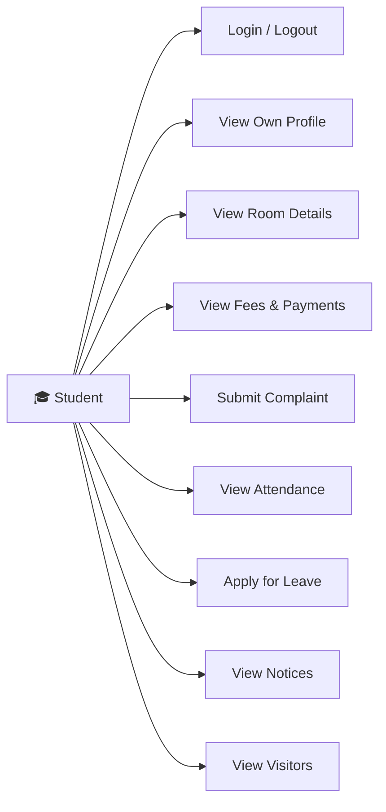
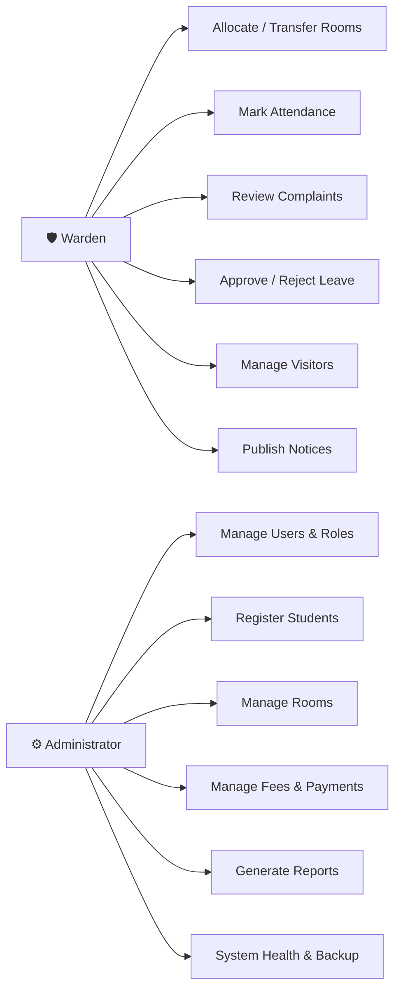

# Software Requirements Specification (SRS)

## Hostel Management System

**Project:** Hostel Management System (HMS)
**Version:** 2.0
**Authors:** Shashankb30, abhijeetcyalgi
**Date:** 30-10-2026
**Status:** Approved

---

## Revision History

| Version | Date | Author | Change Summary |
|---------|------|--------|----------------|
| 1.0 | 18-10-2026 | Shashankb30 | Initial SRS draft with FR-01 to FR-10 and NFR-01 to NFR-08 |
| 2.0 | 30-10-2026 | abhijeetcyalgi | Expanded sections: detailed acceptance criteria, security objectives, RTM, use-case diagrams |

## Approvals

| Role | Name | Signature/Date |
|------|------|----------------|
| Team Lead | Shashank B Jain | 30-10-2026 |
| Developer | Abhijeet Cyalgi | 30-10-2026 |

---

## Table of Contents

1. Introduction
2. Overall Description
3. External Interface Requirements
4. System Features (Detailed Functional Requirements)
5. Non-Functional Requirements (Detailed)
6. Quality Attributes & Acceptance Tests
7. System Models and Diagrams
8. Requirements Traceability Matrix (RTM)

---

## 1. Introduction

### 1.1 Purpose

This document is a Software Requirements Specification (SRS) for the Hostel Management System (HMS). It defines all functional and non-functional requirements, external interfaces, and verification criteria for the system. The intended audience includes developers, QA engineers, course evaluators, and project stakeholders.

### 1.2 Scope

The HMS covers the complete lifecycle of hostel administration for a university setting, including:
- User authentication and role-based access control
- Student registration and profile management
- Room and hostel block management
- Room allocation, transfer, and de-allocation workflows
- Fee invoice generation, payment recording, and receipt management
- Complaint and misconduct tracking with demerit point accumulation
- Daily attendance check-in/check-out logging
- Visitor management with check-in/check-out protocols
- Home/long-leave application and approval workflows
- Notice/announcement broadcasting to targeted audiences

**Excluded:** Core university ERP integration, external payment gateway processing, mobile native application, and physical hardware interfaces.

### 1.3 Audience

- **Developers:** Shashankb30 and abhijeetcyalgi — use for implementation guidance
- **QA Engineers:** Use for test case derivation and verification criteria
- **Course Evaluators:** Use for assessing requirement coverage and traceability
- **Maintenance Teams:** Reference for future enhancements and system understanding

### 1.4 Definitions, Acronyms, and Abbreviations

| Term | Meaning |
|------|---------|
| HMS | Hostel Management System |
| SRS | Software Requirements Specification |
| SAD | Software Architecture Document |
| STP | Software Test Plan |
| FR | Functional Requirement |
| NFR | Non-Functional Requirement |
| RTM | Requirements Traceability Matrix |
| RBAC | Role-Based Access Control |
| PBKDF2 | Password-Based Key Derivation Function 2 |
| CSRF | Cross-Site Request Forgery |
| XSS | Cross-Site Scripting |
| ORM | Object-Relational Mapper |
| CI | Continuous Integration |
| WSGI | Web Server Gateway Interface |

---

## 2. Overall Description

### 2.1 Product Perspective

The HMS is a standalone web application that manages hostel operations for a university. It interacts with three categories of users (Student, Warden, Administrator) through a browser-based interface. The system uses a relational database (SQLite for development, PostgreSQL for production) and runs on a standard web server.

### 2.2 Major Product Functions

1. **Authenticate and authorize users** with role-based access control
2. **Register and manage student profiles** with demographic and academic data
3. **Manage hostel rooms** including capacity, availability, and block assignments
4. **Allocate, transfer, and vacate rooms** based on priority rules and capacity constraints
5. **Generate fee invoices, record payments**, and produce receipts
6. **Track complaints and misconduct** with demerit point accumulation and escalation
7. **Record daily attendance** with check-in/check-out timestamps
8. **Log visitor check-in/check-out** with host student verification
9. **Process leave applications** with approval/rejection workflows
10. **Broadcast notices and announcements** to targeted audiences
11. **Provide system health monitoring** and maintenance-window handling
12. **Support database backup and restore** procedures

### 2.3 User Roles and Characteristics

| Role | Description | Key Characteristics |
|------|-------------|---------------------|
| **Student** | Hostel resident who views own records and submits requests | Limited to own data; expects clear navigation and quick responses |
| **Warden** | Hostel authority who manages operations and approves requests | Needs bulk operations (attendance, allocation); reviews complaints and leaves |
| **Administrator** | System administrator with full access to all modules | Manages users, rooms, fees, and system configuration; generates reports |

### 2.4 Operating Environment

- **Server:** Python 3.12, Django 5.2, WSGI server (Gunicorn in production)
- **Database:** SQLite 3 (development), PostgreSQL (production-ready schema)
- **Client:** Modern web browser (Chrome, Firefox, Edge, Safari) with JavaScript enabled
- **Hosting:** Student laptop for development; cloud VM or university server for deployment
- **Network:** HTTP/HTTPS; Bootstrap CSS loaded from CDN

### 2.5 Constraints

- Team of two developers with two one-week sprints
- Must follow university Software Engineering course guidelines
- No paid cloud services or third-party APIs
- Must support concurrent multi-role access
- Must maintain data integrity through database constraints

---

## 3. External Interface Requirements

### 3.1 User Interfaces

- **Login page:** Username and password fields with a Submit button; forgot-password link
- **Role-based dashboard:** Each role sees a customized dashboard with relevant navigation items and summary cards
- **Forms:** Consistent form layout across all modules with inline validation, error messages, and success confirmations
- **Lists:** Paginated tables with 25 items per page; sortable columns where applicable
- **Responsive design:** Bootstrap-based templates that adapt to desktop and tablet viewports
- **Accessibility:** Semantic HTML, clear focus indicators, and screen-reader-compatible labels

### 3.2 Hardware Interfaces

Not applicable — the system is a web application with no direct hardware interfaces.

### 3.3 Software Interfaces

| Interface | Description |
|-----------|-------------|
| Django ORM | All database interactions go through the ORM; no raw SQL |
| Django Authentication | Built-in authentication framework with custom lockout backend |
| Django Template Engine | Server-side rendering with auto-escaping for XSS protection |
| GitHub Actions API | CI pipeline triggered on pull requests for automated testing |
| Email (SMTP) | Password reset emails via Django's email framework |

### 3.4 Communications

- **Protocol:** HTTP (development), HTTPS (production)
- **Session management:** Cookie-based with HttpOnly flag, 30-minute idle timeout
- **CSRF protection:** Django CSRF middleware with HttpOnly cookie
- **Security headers:** X-Frame-Options: DENY, X-Content-Type-Options: nosniff, X-XSS-Protection: 1

---

## 4. System Features (Detailed Functional Requirements)

Each requirement includes an ID, description, acceptance criteria, and reference test case.

### 4.1 FR-01: User Login and Authentication

| FR ID | Requirement | Actor(s) | Description |
|-------|-------------|----------|-------------|
| FR-01-001 | Login page display | All | The system shall display a login page with username and password fields and a Submit button |
| FR-01-002 | Role-based authentication | All | The system shall authenticate users and redirect them to their role-specific dashboard (Student, Warden, or Administrator) |
| FR-01-003 | Invalid credentials | All | The system shall display "Invalid username or password" for incorrect credentials without revealing which field is wrong |
| FR-01-004 | Blank submission rejection | All | The system shall reject login attempts with blank username or password with validation errors |
| FR-01-005 | Account lockout | All | The system shall lock an account after 5 consecutive failed login attempts and display "Too many failed login attempts" |
| FR-01-006 | Inactive account blocking | All | The system shall block login for inactive or locked accounts with a clear reason message |
| FR-01-007 | Session management | All | The system shall maintain sessions across module navigation with a 30-minute idle timeout |
| FR-01-008 | Logout | All | The system shall end the session on logout, redirect to login, and prevent back-button access to protected pages |
| FR-01-009 | Password reset | All | The system shall allow password reset via email link without requiring the current password |
| FR-01-010 | Account management | Admin | The administrator shall create, edit, deactivate, reactivate, and unlock user accounts with role assignment |

**Acceptance Criteria:** All test cases UT_01 through IT_LOGIN_06 pass.

### 4.2 FR-02: Student Registration

| FR ID | Requirement | Actor(s) | Description |
|-------|-------------|----------|-------------|
| FR-02-001 | Registration form | Admin | The system shall display a form with fields for Name, Roll No., Contact, Address, Course, Year, and Email |
| FR-02-002 | Successful registration | Admin | The system shall create a student record and generate a unique Student ID on valid submission |
| FR-02-003 | Duplicate roll number | Admin | The system shall reject registration with a duplicate roll number displaying "Roll number already exists" |
| FR-02-004 | Duplicate email | Admin | The system shall reject registration with a duplicate email address (case-insensitive) |
| FR-02-005 | Mandatory fields | Admin | The system shall prevent submission with blank Name or Roll No. fields |
| FR-02-006 | Contact validation | Admin | The system shall reject non-numeric phone numbers with a format validation error |
| FR-02-007 | Auto-generated credentials | Admin | Each registered student shall receive a login account with auto-generated credentials |

**Acceptance Criteria:** All test cases UT_04 through IT_REG_07 pass.

### 4.3 FR-03: Room Management

| FR ID | Requirement | Actor(s) | Description |
|-------|-------------|----------|-------------|
| FR-03-001 | Add room | Admin | The system shall allow adding rooms with Room No., capacity, type, and hostel assignment |
| FR-03-002 | Duplicate room | Admin | The system shall reject duplicate room numbers within the same hostel |
| FR-03-003 | Capacity validation | Admin | Room capacity must be a positive integer; zero or negative values are rejected |
| FR-03-004 | Vacancy tracking | Admin, Warden | Room vacancy status shall update automatically after allocation or de-allocation |
| FR-03-005 | Capacity floor | Admin | Capacity cannot be lowered below the current occupancy count |
| FR-03-006 | Deletion protection | Admin | A room with active occupants cannot be deleted |
| FR-03-007 | Availability toggle | Warden | Warden can toggle room availability; occupied rooms cannot be made unavailable |
| FR-03-008 | Room filtering | Admin, Warden | Rooms can be filtered by vacancy status |

**Acceptance Criteria:** All test cases UT_07 through IT_ROOM_14 pass.

### 4.4 FR-04: Room Allocation

| FR ID | Requirement | Actor(s) | Description |
|-------|-------------|----------|-------------|
| FR-04-001 | Vacant room list | Warden | The system shall display only rooms with available capacity for allocation |
| FR-04-002 | Allocate room | Warden | The system shall allocate a vacant room to a student and update occupancy |
| FR-04-003 | Double allocation prevention | Warden | A student with an active allocation cannot be allocated a second room |
| FR-04-004 | Capacity enforcement | Warden | Allocation is blocked when the room is at full capacity |
| FR-04-005 | Room transfer | Warden | The system shall support room transfers with proper occupancy updates on both rooms |
| FR-04-006 | Allocation report | Warden, Admin | The system shall generate allocation reports filtered by date range |
| FR-04-007 | Transactional safety | System | All allocation operations shall be wrapped in database transactions |

**Acceptance Criteria:** All test cases UT_10 through ST_08 pass.

### 4.5 FR-05: Fee Management

| FR ID | Requirement | Actor(s) | Description |
|-------|-------------|----------|-------------|
| FR-05-001 | Fee definition | Admin | The system shall allow defining fees for students with year, description, and amount |
| FR-05-002 | Payment recording | Admin | The system shall record payments with amount, mode (Cash/Online/Card/Bank Transfer), and generate receipts |
| FR-05-003 | Overpayment prevention | Admin | Payment amounts exceeding the outstanding balance shall be rejected |
| FR-05-004 | Status tracking | Admin, Student | Fee status shall be derived from payments: Due, Partially Paid, Paid |
| FR-05-005 | Student fee view | Student | Students shall see only their own fees and payment history |
| FR-05-006 | Duplicate payment prevention | Admin | The system shall prevent duplicate payment entries |
| FR-05-007 | Outstanding dues report | Admin | Report listing unpaid balances with overdue flags and CSV download |

**Acceptance Criteria:** All test cases UT_13 through ST_FEE_03 pass.

### 4.6 FR-06: Complaint Management

| FR ID | Requirement | Actor(s) | Description |
|-------|-------------|----------|-------------|
| FR-06-001 | Submit complaint | Student | Students can submit complaints with category and description |
| FR-06-002 | View complaints | Warden, Admin | Warden/Admin can view and filter all open complaints |
| FR-06-003 | Demerit points | Warden | Demerit points assigned based on misconduct severity accumulate per student |
| FR-06-004 | Status workflow | Warden | Complaints follow Open → In Progress → Resolved workflow with notifications |
| FR-06-005 | Complaint report | Admin | Summary report grouped by category |

**Acceptance Criteria:** All test cases UT_16 through ST_12 pass.

### 4.7 FR-07: Attendance Management

| FR ID | Requirement | Actor(s) | Description |
|-------|-------------|----------|-------------|
| FR-07-001 | Check-in recording | Warden | Record student check-in with timestamp |
| FR-07-002 | Check-out recording | Warden | Record student check-out completing the attendance entry |
| FR-07-003 | Duplicate check-in prevention | Warden | System flags duplicate check-in without prior check-out |
| FR-07-004 | Bulk attendance | Warden | Support marking attendance for multiple students simultaneously |
| FR-07-005 | Attendance report | Warden, Admin | Reports filterable by date range |

**Acceptance Criteria:** All test cases UT_19 through ST_14 pass.

### 4.8 FR-08: Visitor Management

| FR ID | Requirement | Actor(s) | Description |
|-------|-------------|----------|-------------|
| FR-08-001 | Visitor check-in | Admin, Warden | Record visitor details with name, ID proof, purpose, and host student |
| FR-08-002 | ID proof validation | Admin, Warden | Visitor check-in requires ID proof; blank field rejected |
| FR-08-003 | Visitor check-out | Admin, Warden | Check-out records timestamp and calculates visit duration |
| FR-08-004 | Double check-out prevention | Admin, Warden | Already checked-out visitors cannot be checked out again |
| FR-08-005 | Visitor log report | Admin, Warden | Reports filterable by date range and student name |

**Acceptance Criteria:** All test cases UT_22 through ST_16 pass.

### 4.9 FR-09: Home/Long-Leave Application

| FR ID | Requirement | Actor(s) | Description |
|-------|-------------|----------|-------------|
| FR-09-001 | Submit leave | Student | Students submit applications with from/to dates and reason |
| FR-09-002 | Date validation | Student | End date must not precede start date |
| FR-09-003 | Reason required | Student | Leave reason is mandatory |
| FR-09-004 | Approve/Reject | Warden | Warden can approve or reject with remarks |
| FR-09-005 | Overlap detection | System | System flags overlapping dates with existing approved leaves |
| FR-09-006 | Leave history | Student | Students can view all their leave applications with status |

**Acceptance Criteria:** All test cases UT_25 through ST_18 pass.

### 4.10 FR-10: Notice/Information Management

| FR ID | Requirement | Actor(s) | Description |
|-------|-------------|----------|-------------|
| FR-10-001 | Create notice | Warden, Admin | Publish notices with title, content, audience, and expiry |
| FR-10-002 | Title validation | Warden, Admin | Empty title is rejected |
| FR-10-003 | Dashboard display | Student | Published notices appear on student dashboard |
| FR-10-004 | Edit/Delete notice | Warden, Admin | Existing notices can be updated or deleted |
| FR-10-005 | Audience targeting | Warden, Admin | Notices can target all, students only, or wardens only |
| FR-10-006 | Ordering | System | Notices displayed in descending order of publish date |
| FR-10-007 | Search/Filter | All | Notices searchable by keyword |
| FR-10-008 | Role restriction | System | Students cannot create, edit, or delete notices |

**Acceptance Criteria:** All test cases UT_28 through ST_20 pass.

---

## 5. Non-Functional Requirements (Detailed)

### 5.1 Security

#### 5.1.1 Security Objectives

1. **Confidentiality:** Only authenticated and authorized users shall access the system. Students can view only their own records. Passwords are never stored in plaintext.
2. **Integrity:** All data modifications are validated server-side with database constraints. No raw SQL is used; all queries go through the ORM to prevent SQL injection.
3. **Availability:** The system provides health monitoring and maintenance-window handling. Custom error pages prevent information leakage during failures.

#### 5.1.2 Security Requirements

| NFR ID | Requirement | Description | Verification |
|--------|-------------|-------------|--------------|
| NFR-SEC-01 | RBAC enforcement | Every view is protected with `@role_required()` decorator. Unauthenticated users are redirected to login. Wrong-role access returns 403 | Test UT_NFR_01 |
| NFR-SEC-02 | Password hashing | Passwords hashed with PBKDF2-SHA256 (Django default). `PASSWORD_HASHERS` is not overridden | Test UT_NFR_02 |
| NFR-SEC-03 | Session security | `SESSION_COOKIE_HTTPONLY=True`, `CSRF_COOKIE_HTTPONLY=True`, `SESSION_COOKIE_AGE=1800` | Settings audit |
| NFR-SEC-04 | XSS prevention | All templates use Django auto-escaping. `SECURE_BROWSER_XSS_FILTER=True`, `SECURE_CONTENT_TYPE_NOSNIFF=True` | Test UT_NFR_04 |
| NFR-SEC-05 | SQL injection prevention | No `.raw()`, `cursor.execute()`, or `RawSQL()` anywhere in the codebase | Code grep |
| NFR-SEC-06 | Clickjacking protection | `X_FRAME_OPTIONS='DENY'` | Settings audit |
| NFR-SEC-07 | Student data isolation | Fee, complaint, leave, visitor views filter by `student=request.user.student` | Test UT_NFR_03 |

### 5.2 Usability

| NFR ID | Category | Description |
|--------|----------|-------------|
| NFR-02 | Usability | The system shall provide a simple and understandable interface that requires no training. Role-based navigation shows only relevant modules. Forms include inline validation with clear error messages. A usability evaluation is documented in `Documents/process/usability-review.md` |

### 5.3 Performance

| NFR ID | Category | Description |
|--------|----------|-------------|
| NFR-03 | Performance | Common operations (login, search, allocation, fee recording) shall respond in under 3 seconds. Benchmark script validates all 19 major endpoints. Results documented in `Documents/process/performance-baseline.md` |

### 5.4 Reliability

| NFR ID | Category | Description |
|--------|----------|-------------|
| NFR-04 | Reliability | The system shall preserve hostel records accurately. Database backup and restore procedures are implemented via management commands. SOP documented in `Documents/process/backup-and-restore.md`. Multi-model writes use `transaction.atomic()` for rollback safety |

### 5.5 Data Integrity

| NFR ID | Category | Description |
|--------|----------|-------------|
| NFR-05 | Data Integrity | `Student.roll_no` has `unique=True`. `Room.room_no` is unique within its hostel via `UniqueConstraint`. Allocation has a partial unique index for one active allocation per student. FK `on_delete` is set appropriately on every ForeignKey |

### 5.6 Maintainability

| NFR ID | Category | Description |
|--------|----------|-------------|
| NFR-06 | Maintainability | Each SRS module maps to exactly one Django app (11 apps total). No circular imports between apps. `ruff check .` passes with zero warnings. Module-to-app mapping documented in the SAD |

### 5.7 Scalability

| NFR ID | Category | Description |
|--------|----------|-------------|
| NFR-07 | Scalability | `Hostel` entity at the schema root. `Room`, `Student`, and all per-hostel models reference `Hostel` via FK. Reports and dashboards support filtering by hostel. Same room number allowed across different hostels |

### 5.8 Availability

| NFR ID | Category | Description |
|--------|----------|-------------|
| NFR-08 | Availability | `GET /health/` returns 200 with `{"status":"ok"}` when healthy. A maintenance view displays a "temporarily down" page. Custom error templates for 400, 403, 404, 500 prevent information leakage |

---

## 6. Quality Attributes & Acceptance Tests

### Exit Criteria for Acceptance

- All high-priority functional requirements (FR-01 through FR-10) are implemented and verified
- No critical NFR failures
- RTM shows all test cases passed
- All 679+ automated tests pass via `python manage.py test`
- `ruff check .` passes with zero warnings
- Performance benchmark shows all endpoints under 3 seconds

### Acceptance Test Suites

| Suite | Coverage |
|-------|----------|
| Authentication | Login, lockout, session, password reset (UT_01 through IT_LOGIN_06) |
| Student Registration | Registration, duplicates, validation (UT_04 through IT_REG_07) |
| Room Management | Room CRUD, capacity, vacancy (UT_07 through IT_ROOM_14) |
| Room Allocation | Allocation, transfer, reports (UT_10 through ST_08) |
| Fee Management | Fees, payments, receipts, reports (UT_13 through ST_FEE_03) |
| Complaint Management | Complaints, demerit points (UT_16 through ST_12) |
| Attendance | Check-in/out, reports (UT_19 through ST_14) |
| Visitor Management | Visitor logs, check-in/out (UT_22 through ST_16) |
| Leave Application | Leave workflow (UT_25 through ST_18) |
| Notice Management | Notices, audience targeting (UT_28 through ST_20) |
| NFR Verification | Security, performance, integrity (UT_NFR_01 through UT_NFR_13) |

---

## 7. System Models and Diagrams

### 7.1 UML Use-Case Diagram — Student Actor

### 7.2 UML Use-Case Diagram — Warden & Administrator Actors

---

## 8. Requirements Traceability Matrix (RTM)

| Requirement ID | Module | Test Case IDs | Implementation | Status |
|----------------|--------|---------------|----------------|--------|
| FR-01 | User Login | UT_01, UT_02, UT_03, IT_01-IT_03, ST_01-ST_02, UT_LOGIN_04-05, ST_LOGIN_03-04, IT_LOGIN_04-06 | `accounts/` app | Implemented |
| FR-02 | Student Registration | UT_04-UT_06, IT_04-IT_06, ST_03-ST_04, UT_REG_07-08, IT_REG_07 | `students/` app | Implemented |
| FR-03 | Room Management | UT_07-UT_09, IT_07-IT_09, ST_05-ST_06, UT_ROOM_10-13, IT_ROOM_12-14 | `rooms/` app | Implemented |
| FR-04 | Room Allocation | UT_10-UT_12, IT_10-IT_12, ST_07-ST_08 | `allocation/` app | Implemented |
| FR-05 | Fee Management | UT_13-UT_15, IT_13-IT_15, ST_09-ST_10, UT_FEE_04-07, IT_FEE_04, ST_FEE_03 | `fees/` app | Implemented |
| FR-06 | Complaint Management | UT_16-UT_18, IT_16-IT_18, ST_11-ST_12 | `complaints/` app | Implemented |
| FR-07 | Attendance Management | UT_19-UT_21, IT_19-IT_21, ST_13-ST_14 | `attendance/` app | Implemented |
| FR-08 | Visitor Management | UT_22-UT_24, IT_22-IT_24, ST_15-ST_16 | `visitors/` app | Implemented |
| FR-09 | Leave Application | UT_25-UT_27, IT_25-IT_27, ST_17-ST_18 | `leave/` app | Implemented |
| FR-10 | Notice Management | UT_28-UT_30, IT_28-IT_30, ST_19-ST_20 | `notices/` app | Implemented |
| NFR-01 | Security (RBAC) | UT_NFR_01 | `core/roles.py`, all `views.py` | Implemented |
| NFR-02 | Usability | Usability review document | `Documents/process/usability-review.md` | Implemented |
| NFR-03 | Performance | UT_NFR_06 | `scripts/benchmark_performance.py` | Implemented |
| NFR-04 | Reliability | UT_NFR_08, UT_NFR_09 | `backup_database.py`, `restore_database.py` | Implemented |
| NFR-05 | Data Integrity | UT_NFR_10 | `core/models.py` constraints | Implemented |
| NFR-06 | Maintainability | UT_NFR_11 (ruff) | 11 Django apps, `ruff.toml` | Implemented |
| NFR-07 | Scalability | UT_NFR_12 | `Hostel` model with FKs | Implemented |
| NFR-08 | Availability | UT_NFR_13 | `/health/` endpoint, error handlers | Implemented |
