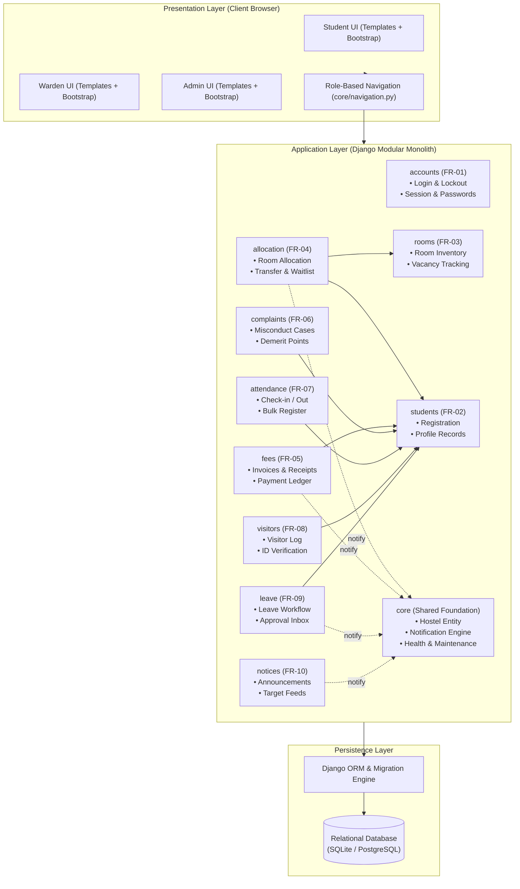
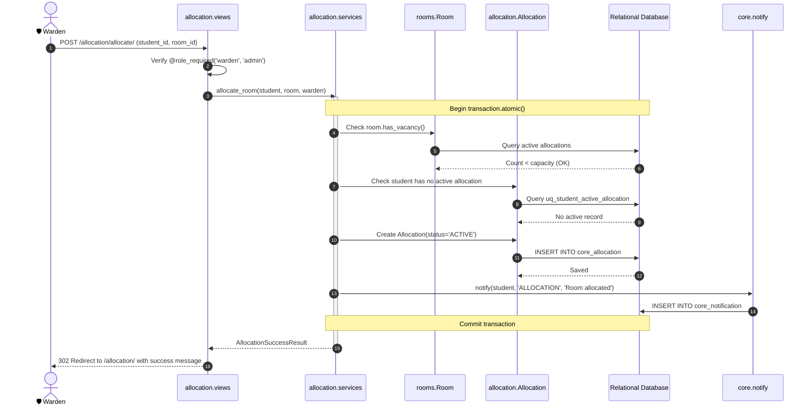
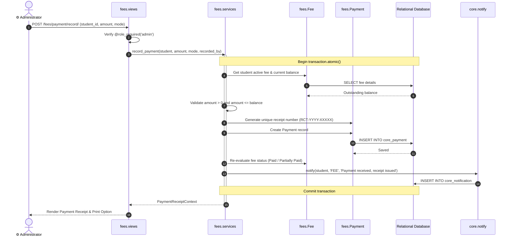

# Software Architecture and Design Specification

**Project:** Hostel Management System (HMS)  
**Version:** 2.0  
**Authors:** Shashank B Jain (@Shashankb30), Abhijeet Cyalgi (@abhijeetcyalgi)  
**Date:** 30-10-2026  
**Status:** Approved  

---

## Revision History

| Version | Date | Author | Change Summary |
|---------|------|--------|----------------|
| 1.0 | 18-10-2026 | Shashankb30 | Initial architecture specification draft (layered architecture, subsystems) |
| 1.1 | 23-10-2026 | Shashankb30 | Updated component interactions and Sprint 1 module mappings |
| 2.0 | 30-10-2026 | abhijeetcyalgi | Comprehensive expansion: STRIDE threat model, UML sequence diagrams, component API specs, error & monitoring architecture, NFR hardening verification |

## Approvals

| Role | Name | Signature / Email | Date |
|------|------|-------------------|------|
| Team Lead / Architect | Shashank B Jain | shashank@example.com | 30-10-2026 |
| Core Developer / QA | Abhijeet Cyalgi | abhijeetcyalgi@gmail.com | 30-10-2026 |
| Course Evaluator | Course Coordinator | evaluator@pes.edu | 30-10-2026 |

---

## Table of Contents

1. [Introduction](#1-introduction)
2. [Document Overview](#2-document-overview)
3. [Architecture](#3-architecture)
   - 3.1 [Goals & Constraints](#31-goals--constraints)
   - 3.2 [Stakeholders & Concerns](#32-stakeholders--concerns)
   - 3.3 [Component (UML) Diagram](#33-component-uml-diagram)
   - 3.4 [Component Descriptions](#34-component-descriptions)
   - 3.5 [Chosen Architecture Pattern & Rationale](#35-chosen-architecture-pattern-and-rationale)
   - 3.6 [Technology Stack & Data Stores](#36-technology-stack--data-stores)
   - 3.7 [Risks & Mitigations](#37-risks--mitigations)
   - 3.8 [Traceability to Requirements](#38-traceability-to-requirements)
   - 3.9 [Security Architecture & STRIDE Threat Modeling](#39-security-architecture)
4. [Design](#4-design)
   - 4.1 [Design Overview](#41-design-overview)
   - 4.2 [UML Sequence Diagrams](#42-uml-sequence-diagrams)
   - 4.3 [API Design](#43-api-design)
   - 4.4 [Error Handling, Logging & Monitoring](#44-error-handling-logging--monitoring)
   - 4.5 [UX Design](#45-ux-design)
   - 4.6 [Open Issues & Next Steps](#46-open-issues--next-steps)
5. [Appendices](#5-appendices)

---

## 1. Introduction

### 1.1 Purpose
This document specifies the software architecture and detailed design of the **Hostel Management System (HMS)**. It articulates the structural decomposition of the application, inter-subsystem protocols, data flow, security controls, and design patterns, serving as the definitive technical reference for developers, QA engineers, security auditors, instructors, and maintenance teams.

### 1.2 Scope
Covers the end-to-end web system across three primary actors (**Student**, **Warden**, **Administrator**) encompassing all ten core functional modules:
- FR-01: User Login, Session Management & Account Lockout
- FR-02: Student Registration & Profile Management
- FR-03: Room & Block Inventory Management
- FR-04: Room Allocation, Vacancy Tracking & Transfers
- FR-05: Fee Structures, Payment Processing & Receipt Generation
- FR-06: Disciplinary Tracking, Misconduct Complaints & Demerit Points
- FR-07: Attendance Check-In / Check-Out & Register Reporting
- FR-08: Visitor Logging, Host Student Verification & Pass Tracking
- FR-09: Home / Long-Leave Applications & Approval Workflow
- FR-10: Notice & Announcement Broadcasting with Role/Block Targeting
- Cross-Cutting: Notification Service, System Health Monitoring, Maintenance Windows, and Backup/Restore

### 1.3 Audience
- **Developers:** Implementation blueprint for Django apps, services, and models.
- **QA Engineers:** Test boundary definition, interface verification, and validation rules.
- **Security Auditors:** Assessment of RBAC, session management, and threat mitigations.
- **Instructors / Evaluators:** Verification of architectural principles (IEEE 42010, STRIDE, layered patterns).

### 1.4 Definitions, Acronyms, and Abbreviations
- **HMS:** Hostel Management System
- **SRS / SAD / STP:** Software Requirements Specification / Software Architecture Document / Software Test Plan
- **RBAC:** Role-Based Access Control
- **MVT:** Model-View-Template pattern (Django's variant of MVC)
- **ORM:** Object-Relational Mapping
- **STRIDE:** Spoofing, Tampering, Repudiation, Information Disclosure, Denial of Service, Elevation of Privilege
- **PBKDF2:** Password-Based Key Derivation Function 2
- **CSRF / XSS:** Cross-Site Request Forgery / Cross-Site Scripting
- **ADR:** Architecture Decision Record

---

## 2. Document Overview

### 2.1 How to Use This Document
Provides structural views of the system:
- Architectural views (Component diagrams, Layered patterns, Technology stack) in Section 3.
- Security architecture and threat model (STRIDE matrix) in Section 3.9.
- Dynamic runtime views (UML Sequence diagrams for key transactional flows) in Section 4.2.
- Component API specifications in Section 4.3.
- Operational design (Health checks, backup/restore, error handling) in Section 4.4.

### 2.2 Related Documents
1. **SRS:** `Documents/SRS_Document.md`
2. **STP:** `Documents/Test_Plan_Document.md`
3. **Test Matrix:** `TEST_PLAN_MATRIX.md`
4. **ADR 0001:** `Documents/adr/0001-tech-stack.md`
5. **NFR Hardening Report:** `Documents/design/nfr-hardening-report.md`
6. **ER Schema:** `Documents/design/er-diagram.md`

---

## 3. Architecture

### 3.1 Goals & Constraints
- **Goals:** 
  - Sub-3-second page load latency across all endpoints under typical load.
  - 99.9% uptime with automated `/health/` monitoring and graceful maintenance mode.
  - Strict student-data isolation (students can only see their own fees, complaints, room, and leave).
  - High data integrity with atomic transactions and server-side database constraints.
- **Constraints:**
  - Standard Python 3.12 / Django 5.2 stack running without costly third-party cloud infrastructure.
  - Zero external paid APIs; SQLite for rapid development and testing, PostgreSQL-ready for production.
  - Academic sprint schedule (Sprint 1: Oct 19–23; Sprint 2: Oct 26–30).

### 3.2 Stakeholders & Concerns

| Stakeholder | Key Concerns | Architectural Response |
|-------------|--------------|------------------------|
| **Students** | Privacy, fast navigation, clarity of fees and room status | Row-level data isolation, mobile-responsive UI, instant notification feed |
| **Wardens** | Swift attendance recording, conflict-free room allocation | Bulk-marking attendance tools, atomic room allocation locking, leave approval inbox |
| **Administrators** | Auditability, user management, financial tracking, system backups | Comprehensive reports, role-based user management, timestamped JSON database backups |
| **Course Evaluators** | Adherence to SE principles, modularity, requirement traceability | 1:1 SRS module to Django app mapping, strict ADR documentation, automated CI |

### 3.3 Component (UML) Diagram



### 3.4 Component Descriptions
- **Presentation Layer (Web UI):** Server-rendered Django templates styled with responsive Bootstrap 5. Employs contextual breadcrumbs and role-filtered navigation tabs (`core/navigation.py`).
- **Auth Service (`accounts`):** Manages user credentials, lockout counter (locks after 5 failed attempts), idle session expiry (30 minutes), and password resets.
- **Student Service (`students`):** Handles student demographics, institutional roll numbers, contacts, and automatic credentials provisioning.
- **Room Service (`rooms`):** Manages block and room inventory, capacities, floor plans, and computed vacancy numbers.
- **Allocation Service (`allocation`):** Coordinates transactional allocation, preventing over-capacity allocations via partial unique indexes and atomic database blocks.
- **Fee Service (`fees`):** Manages fee liabilities, records partial/full payments, auto-generates receipt numbers, and calculates outstanding dues.
- **Disciplinary Service (`complaints`):** Tracks complaints and accumulates student demerit points based on incident severity.
- **Attendance Service (`attendance`):** Logs check-in and check-out events and provides daily roll-call summaries.
- **Visitor Service (`visitors`):** Logs external visitor check-in, host student verification, and check-out timestamps.
- **Leave Service (`leave`):** Manages student leave applications and warden review workflows with overlap checks.
- **Notice Service (`notices`):** Broadcasts announcements filtered by role (All, Student, Warden) and expiry dates.
- **Core Platform (`core`):** Houses the multi-hostel root entity, central in-app notification engine, `/health/` monitoring probe, and database backup/restore commands.

### 3.5 Chosen Architecture Pattern and Rationale
- **Pattern:** Layered Modular Monolith (Model-View-Template / Clean Service Layer).
- **Rationale:** Microservices were evaluated and rejected due to excessive network overhead, distributed transaction complexities, and deployment overhead for a two-person team. The modular monolith encapsulates each SRS module inside its own Django application with explicit service boundaries, allowing complete cohesion while sharing a single performant database and migration engine.

### 3.6 Technology Stack & Data Stores
- **Programming Language:** Python 3.12
- **Web Framework:** Django 5.2
- **Front-end:** Django Templates, Bootstrap 5, FontAwesome icons
- **Database:** SQLite 3 (Development & CI), PostgreSQL-compatible schema
- **Security:** PBKDF2-SHA256 password hashing, HttpOnly session/CSRF cookies, XSS auto-escaping
- **Linting & Code Quality:** Ruff (`ruff check .`)
- **CI / Automation:** GitHub Actions (`.github/workflows/ci.yml`)

### 3.7 Risks & Mitigations

| Risk | Impact | Likelihood | Mitigation Strategy |
|------|--------|------------|---------------------|
| Double Room Allocation during concurrent booking | High | Medium | Enforce database-level partial unique index `uq_student_active_allocation` and wrap allocation in `transaction.atomic()` |
| Student Data Leakage across user accounts | Critical | Low | Hardened row-level filtering (`Student.objects.get(user=request.user)`) and automated test `test_UT_NFR_03__cross_student_access_denied` |
| Session Hijacking or Stale Sessions on shared computers | High | Low | `SESSION_COOKIE_HTTPONLY=True`, `SESSION_COOKIE_AGE=1800`, cache-control `no-store` headers on logout |
| Database Corruption or Unrecoverable Failure | High | Low | Automated `backup_database` command creating timestamped JSON snapshots in `backups/` and tested `restore_database` procedure |

### 3.8 Traceability to Requirements

| SRS Requirement | Component / App | Service / Model | Key Constraints / Logic |
|-----------------|-----------------|-----------------|-------------------------|
| FR-01: Login | `accounts` | `UserAccount`, `LoginView` | 5 failed attempts lockout, PBKDF2 hashing |
| FR-02: Student Reg | `students` | `Student`, `StudentForm` | Unique roll number, unique email |
| FR-03: Rooms | `rooms` | `Room`, `RoomService` | Unique room per hostel, positive capacity |
| FR-04: Allocation | `allocation` | `Allocation`, `AllocationService` | Single active allocation constraint, atomic execution |
| FR-05: Fees | `fees` | `Fee`, `Payment`, `FeeService` | Overpayment checks, unique receipt numbers |
| FR-06: Complaints | `complaints` | `Complaint`, `ComplaintService` | Demerit point accumulation |
| FR-07: Attendance | `attendance` | `AttendanceRecord` | Chronological time check, bulk entry |
| FR-08: Visitors | `visitors` | `Visitor`, `VisitorService` | Mandatory ID proof, host student validation |
| FR-09: Leave | `leave` | `LeaveApplication` | End date >= start date, date overlap detection |
| FR-10: Notices | `notices` | `Notice`, `NoticeService` | Role targeting, active expiry filters |

### 3.9 Security Architecture & STRIDE Threat Modeling

```mermaid
graph TD
    User([User Browser]) -->|HTTPS / TLS| LB[Reverse Proxy / WSGI]
    LB -->|Secure Headers| App[Django Application Shell]
    App -->|@role_required| AuthZ[RBAC Authorization Engine]
    AuthZ -->|Clean Service Call| Modules[Functional Business Modules]
    Modules -->|Parameterized Query| ORM[Django ORM]
    ORM -->|Encrypted Connection| DB[(Hostel Database)]
```

#### STRIDE Threat Modeling Matrix

| Threat Category | Potential Attack Vector | HMS Architectural Mitigation |
|-----------------|-------------------------|------------------------------|
| **S**poofing | Attacker impersonates valid student or warden | Salted PBKDF2 password hashing, secure session cookies (`HttpOnly`, `SameSite=Lax`), account lockout after 5 consecutive failures |
| **T**ampering | Modifying room allocations or fee payments directly | Server-side validation on all forms, database check constraints, multi-step writes locked inside `transaction.atomic()` |
| **R**epudiation | User claims an action was never taken | Automatic audit timestamps (`TimeStampedModel`), visitor and payment logs recording the recording official |
| **I**nformation Disclosure | Student views another student's fees or records | Strict row-level queryset scoping (`user=request.user`), custom 403/404/500 handlers hiding system stack traces |
| **D**enial of Service | Brute-force authentication flood or query exhaustion | Configurable lockout backend, paginated lists (25 items/page) with `select_related()` to eliminate N+1 queries |
| **E**levation of Privilege | Student attempts to invoke warden or admin URLs | Centralized `@role_required(*roles)` decorator on every view; unauthorized requests abort with HTTP 403 |

---

## 4. Design

### 4.1 Design Overview
The system follows a strict 3-tier structure within the Django framework:
1. **Views:** Handle HTTP requests, extract parameters, perform authentication & role checks.
2. **Services (`services.py`):** Pure Python business logic; no UI dependencies; manages transactions and multi-entity invariants.
3. **Models (`models.py`):** Encapsulate data schema, field validators, and relational integrity.

---

### 4.2 UML Sequence Diagrams

#### Sequence Diagram 1: Transactional Room Allocation Workflow


#### Sequence Diagram 2: Fee Payment & Receipt Generation Workflow


---

### 4.3 API Design

#### Endpoint 1: System Health Check Probe
- **URL:** `GET /health/`
- **Access:** Public / Monitoring Agent
- **Description:** Returns JSON representation of application and database operational state.
- **Response Format (200 OK):**
```json
{
  "status": "ok",
  "database": "connected",
  "service": "Hostel Management System",
  "version": "2.0",
  "timestamp": "2026-10-30T10:00:00Z"
}
```
- **Error Response (503 Service Unavailable):**
```json
{
  "status": "unhealthy",
  "database": "disconnected",
  "error": "database connection failed"
}
```

#### Endpoint 2: Room Allocation API
- **URL:** `POST /allocation/allocate/`
- **Access:** Role: `warden`, `admin`
- **Request Parameters:**
  - `student_id`: Integer (Mandatory)
  - `room_id`: Integer (Mandatory)
- **Response (302 Redirect on success):** Redirects to `/allocation/` with success flash message.
- **Error Responses:**
  - `400 Bad Request`: Room full or invalid student ID.
  - `403 Forbidden`: User role is Student.
  - `409 Conflict`: Student already has an active room allocation.

#### Endpoint 3: Student Leave Submission API
- **URL:** `POST /leave/apply/`
- **Access:** Role: `student`
- **Request Parameters:**
  - `start_date`: Date `YYYY-MM-DD` (Mandatory)
  - `end_date`: Date `YYYY-MM-DD` (Mandatory)
  - `reason`: String (Mandatory, non-blank)
- **Error Responses:**
  - `400 Bad Request`: `end_date < start_date` or overlapping active approved leave exists.

---

### 4.4 Error Handling, Logging & Monitoring

- **Custom Error Handlers:** 
  - `handler400 = 'core.views.bad_request_view'` -> Renders `templates/400.html`
  - `handler403 = 'core.views.permission_denied_view'` -> Renders `templates/403.html`
  - `handler404 = 'core.views.page_not_found_view'` -> Renders `templates/404.html`
  - `handler500 = 'core.views.server_error_view'` -> Renders `templates/500.html`
- **Information Leakage Prevention:** Stack traces and internal paths are hidden in production; users receive friendly error cards with support navigation.
- **Monitoring:** Periodic uptime ping against `GET /health/`.
- **Maintenance Windows:** `GET /maintenance/` displays a styled maintenance notice when administrative maintenance is scheduled.

---

### 4.5 UX Design
- **Consistent Layout:** Shared `base.html` offering responsive navigation, breadcrumbs, message banners (success, warning, error), and user profile drawer.
- **Accessibility:** High contrast Bootstrap palette, semantic `<nav>`, `<main>`, `<form>`, and accessible form labels.
- **Responsive Tables:** Overflow containers with pagination buttons (25 records/page) preserving usability on mobile and tablet screens.

---

### 4.6 Open Issues & Next Steps
- **Future Enhancements:**
  - Biometric fingerprint scanner integration for automated attendance logging.
  - Integration with university central payment gateway (Razorpay / UPI) for online fees.
  - Native Progressive Web App (PWA) shell for offline notice browsing.

---

## 5. Appendices

### 5.1 Glossary
- **ADR:** Architecture Decision Record
- **Partial Index:** A database index with a `WHERE` condition (e.g. `is_active=True`).
- **Demerit Points:** Disciplinary penalties accumulated against student records.

### 5.2 References
1. IEEE Recommended Practice for Architectural Description of Software-Intensive Systems (IEEE 42010).
2. OWASP Top 10 Web Application Security Risks (2021).
3. Django Documentation (v5.2): Architecture and Security Best Practices.
4. PES University Software Engineering Course Deliverables (Unit 2).

### 5.3 Tools
- **PlantUML / Mermaid:** Diagram generation.
- **Ruff:** Python static analysis and linting.
- **Django Test Client:** Automated test execution.
