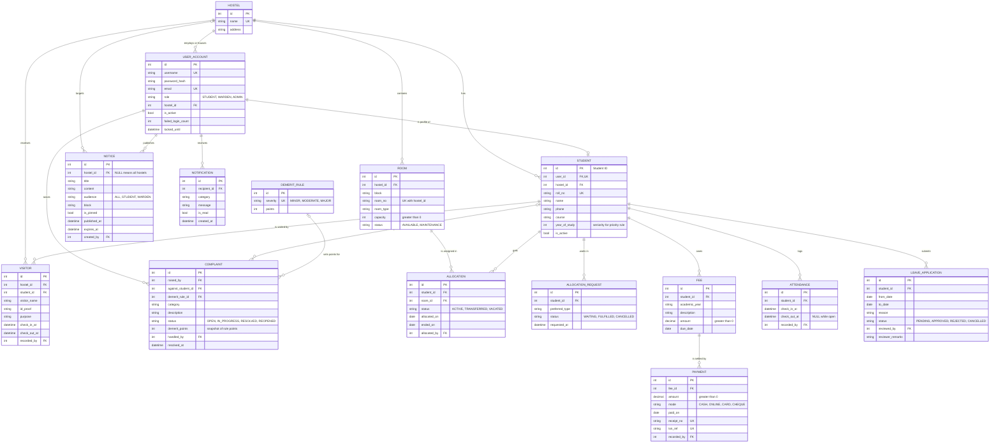

# ER Diagram and Relational Schema

| Field | Value |
|---|---|
| Issue | #8 (SETUP.07) |
| Requirements | NFR-05 (data integrity), NFR-06 (modularity), NFR-07 (scalability) |
| Test case | `UT_SETUP_05` (run `python scripts/verify_schema.py`) |
| Related | [ADR 0001](../adr/0001-tech-stack.md), [architecture diagram](architecture-diagram.md), [`schema.sql`](schema.sql) |

## 1. Entity-relationship diagram

`USER_ACCOUNT` is the `User` entity from the issue; the table is not called `user` because that is a reserved word in PostgreSQL. `LEAVE_APPLICATION` is the `Leave` entity for the same reason. `HOSTEL` (ADR 0001, NFR-07) and `ALLOCATION_REQUEST` (waiting list and priority rule, SAD section 5) are supporting entities added to the 13 named in the issue.

## 2. Entities by module

| Entity | Django app (ADR 0001) | SRS module | Purpose |
|---|---|---|---|
| Hostel, Notification | `core` | Shared | Top of the data model; in-app messages from `core.notify()` |
| User (`user_account`) | `accounts` | FR-01 | Credentials, role, lockout state |
| Student | `students` | FR-02 | Personal, academic and contact details |
| Room | `rooms` | FR-03 | Rooms, capacity, maintenance flag |
| Allocation, AllocationRequest | `allocation` | FR-04 | Room history, transfers, waiting list |
| Fee, Payment | `fees` | FR-05 | Charges and recorded payments |
| Complaint, DemeritRule | `complaints` | FR-06 | Complaints, misconduct, demerit points |
| Attendance | `attendance` | FR-07 | Check-in and check-out entries |
| Visitor | `visitors` | FR-08 | Visitor log |
| Leave (`leave_application`) | `leave` | FR-09 | Leave applications and review |
| Notice | `notices` | FR-10 | Published notices |

Foreign keys only point in the direction allowed by the ADR dependency table, so there are no cycles. `complaints`, `attendance`, `visitors` and `leave` reference `students`; `allocation` references `students` and `rooms`; `fees` references `students`; `core` and `accounts` reference no feature module.

## 3. Keys and integrity constraints (NFR-05)

| Rule | Enforced by | Test Plan case |
|---|---|---|
| Unique Roll No. | `UNIQUE(student.roll_no)` | UT_06_Reg |
| Unique Room No. within a hostel | `UNIQUE(room.hostel_id, room.room_no)` | UT_08_Room |
| Room capacity is positive | `CHECK(capacity > 0)` | UT_09_Room |
| **One active allocation per student** | Partial unique index `allocation(student_id) WHERE status='ACTIVE'` | IT_11_Alloc |
| Allocation end date only when not active | `CHECK` on `status` and `ended_on` | IT_12_Alloc |
| One waiting request per student | Partial unique index on `allocation_request` | UT_12_Alloc |
| Payment amount is positive | `CHECK(amount > 0)` | IT_14_Fee |
| No duplicate receipt or double-submitted payment | `UNIQUE(receipt_no)`, `UNIQUE(txn_ref)` | ST_10_Fee |
| Complaint description is not blank | `CHECK(length(trim(description)) > 0)` | UT_17_Comp |
| Points only against a student | `CHECK(demerit_points = 0 OR against_student_id IS NOT NULL)` | IT_16_Comp |
| One open attendance entry per student | Partial unique index `attendance(student_id) WHERE check_out_at IS NULL` | UT_21_Att |
| Check-out is after check-in | `CHECK` on attendance and visitor | ST_14_Att, IT_22_Vis |
| Visitor ID proof is required | `CHECK(length(trim(id_proof)) > 0)` | UT_24_Vis |
| Leave ends on or after it starts; reason required | `CHECK(to_date >= from_date)`, reason check | UT_26_Leave, UT_27_Leave |
| Notice title is required | `CHECK(length(trim(title)) > 0)` | UT_29_Notice |
| Valid references | Foreign keys | All |

Rules that need several rows are enforced by the service layer inside a transaction, as ADR 0001 requires: total paid does not exceed the fee (IT_13_Fee), room occupancy does not exceed capacity (IT_10_Alloc, with a row lock on PostgreSQL), overlapping leave is flagged (IT_27_Leave), and the phone number format is checked by a form validator (IT_06_Reg).

## 4. Derived values (never stored)

| Value | Computed from |
|---|---|
| Room occupancy and vacancy | `COUNT(allocation WHERE status='ACTIVE')` against `room.capacity` |
| Fee paid, balance, Unpaid / Partially Paid / Paid | `fee.amount` and `SUM(payment.amount)` |
| Student demerit total | `SUM(complaint.demerit_points)` per `against_student_id` |
| Visit duration | `visitor.check_out_at - visitor.check_in_at` |

`complaint.demerit_points` is a snapshot of `demerit_rule.points` taken when the points are assigned, so editing a rule later does not rewrite history.

## 5. How the design supports NFR-06 and NFR-07

- **NFR-07 (more hostels):** every hostel-owned record reaches `hostel` directly (`room`, `student`, `visitor`, `notice`) or through its student. A new hostel is one new row. Room numbers are unique per hostel, not globally.
- **NFR-07 (more students and rooms):** all foreign keys and the lookup columns (`roll_no`, `room_no`, `receipt_no`, status and date columns) are indexed.
- **NFR-06 (modularity):** each module owns its tables and only links to `student`, `room` or `hostel`, matching the boundary rules in ADR 0001.

## 6. Relationship to the implementation

`schema.sql` is the reference design, written in portable SQL and verified on SQLite by `scripts/verify_schema.py`. SETUP.08 turns it into Django models and migrations, which become the source of truth. Differences found then (for example Django's `<app>_<model>` table names) are recorded as deviations in the SAD.
