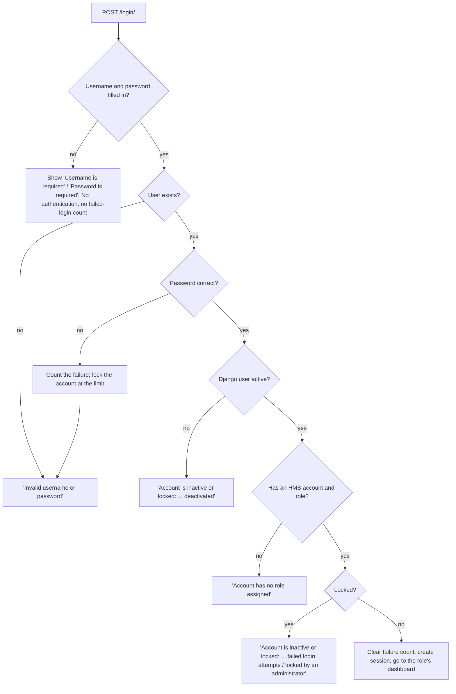

# User Login and Account Management (FR-01 · Issues #15 to #26)

Traceability: FR-01 (R1), UC-01 · NFR-01 (security), NFR-02 (simple UI) · Test Plan: `UT_01` to `UT_03`, `IT_01` to `IT_03`, `ST_01`, `ST_02`, plus `UT_LOGIN_04/05`, `IT_LOGIN_04/05/06`, `ST_LOGIN_03/04`

All of FR-01 lives in the `accounts` app. It adds **no database tables**: the account fields it needs (`role`, `is_locked`, `failed_login_attempts`) already exist on `core.UserAccount`.

## How a login attempt is decided



The reason for a blocked account is only shown when the **password is correct**, so a stranger cannot find out which accounts are inactive or locked. The one exception is the attempt that triggers a lock, which tells the user the account is now locked (UC-01 exception 4b).

## What was built, by issue

| Issue | Story | Where |
|---|---|---|
| #16 | Login page with Username, Password (masked) and a submit button | `accounts/views.py` `HmsLoginView`, `templates/registration/login.html` |
| #17 | Valid Student credentials log in and reach the Student dashboard | `accounts/services.py` `authenticate_credentials`, `accounts/forms.py` `LoginForm` |
| #18 | Wrong credentials show `Invalid username or password`; the same text for an unknown user and a wrong password | `accounts/services.py` |
| #19 | Each role lands on its own dashboard (`HmsLoginView.get_default_redirect_url`) | `accounts/views.py`, `core/roles.py` |
| #20 | Inactive or locked accounts are refused, with the reason, and no session is created | `accounts/services.py`, `core/error_messages.py` |
| #21 | Blank username or password shows errors and never reaches authentication | `accounts/forms.py` |
| #22 | Session survives navigation; ends on idle timeout or browser close | `config/settings.py` (`SESSION_*`) |
| #23 | Logout (POST), confirmation message, no-store headers so Back cannot reopen protected pages | `accounts/views.py` `logout_view`, `accounts/middleware.py` |
| #24 | Forgot password: email link, set a new password, link works once and expires | `accounts/views.py`, `templates/registration/password_reset_*` |
| #25 | Administrator lists, creates, edits, deactivates, reactivates and unlocks accounts | `accounts/user_views.py`, `user_forms.py`, `user_service.py` |
| #26 | Lock after N wrong passwords; administrator unlocks | `accounts/lockout.py`, `unlock_account` command |

## Settings you can change (environment variables, see `.env.example`)

| Variable | Default | Meaning |
|---|---|---|
| `HMS_MAX_FAILED_LOGINS` | 5 | Wrong passwords in a row before an account locks |
| `HMS_SESSION_TIMEOUT_MINUTES` | 30 | Idle minutes before the user must log in again |
| `HMS_RESET_LINK_MINUTES` | 60 | How long a password reset link works |
| `EMAIL_BACKEND` and `EMAIL_*` | console | Where reset emails go. The default prints them in the terminal |

## Decisions worth knowing

- **One message for two mistakes.** Unknown user and wrong password give the same text, and the code does the same hashing work for both, so neither the message nor the response time shows which one was wrong (FR-01.03).
- **Passwords are never stored in plain text.** Django's PBKDF2 hashing is used, and the password field is never filled back into the page.
- **Logout is POST only.** A link or an image on another site cannot log a user out. The top-bar button already posts a form.
- **Locking and deactivating are different.** *Deactivate* turns the Django account off (the person has left). *Lock* is the security brake after too many wrong passwords. Resetting a password clears the failed-login count but does **not** unlock a locked account; only an administrator can.
- **Nobody can change their own role or deactivate themselves** on the Users & Roles screen, so an administrator cannot lock themselves out by accident.
- **If the only administrator is locked out,** run `python manage.py unlock_account <username>` on the server.
- **Administrator accounts** get `is_staff` and `is_superuser` so the Admin Site menu item works. Other roles never get them.
- **Accounts created here have no Student record.** The student's personal details are added by FR-02 (Student Registration).
- **Reset emails need an email address** on the account. The seed data now gives every seeded account `<username>@hms.example`.

## Try it

```bash
python manage.py migrate
python manage.py seed_data
python manage.py runserver
```

1. Open <http://127.0.0.1:8000/login/>. Log in as `stu1023` / `Pass@123`, `wdn05` / `Warden@12`, `admin01` / `Admin@12` and check each dashboard.
2. Try a wrong password, then a blank form, then `stu9999` / `Pass@123` (inactive).
3. Click **Forgot password?**, enter `stu1023@hms.example`, and copy the link printed in the terminal.
4. As `admin01`, open **Users & Roles** to add, edit, deactivate and unlock accounts.

## Running the tests

```bash
python manage.py test accounts            # all login and account tests
python scripts/update_test_matrix.py      # run them and fill in TEST_PLAN_MATRIX.md
```

Test names start with their Test Plan ID (for example `test_UT_02_Login__...`), which is how `update_test_matrix.py` knows which row to update.
