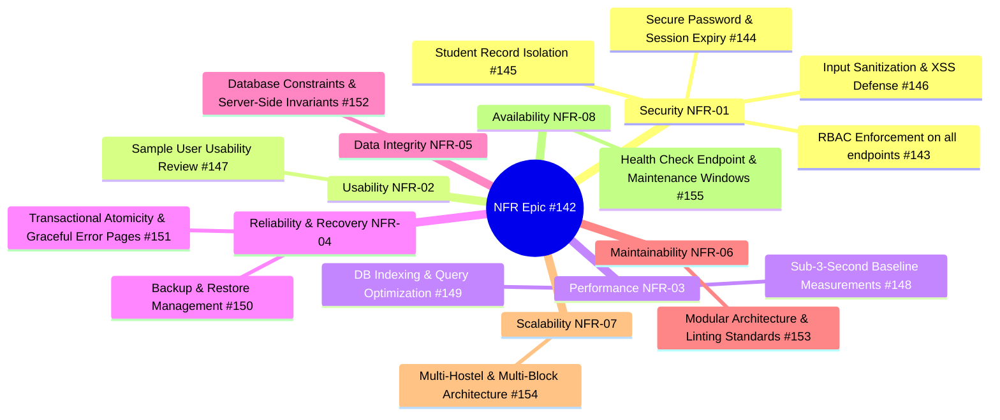

# 🛡️ Non-Functional Requirements (NFR) Hardening & Architectural Verification Report

**Epic Issue**: `#142` (`[EPIC] NFR - Non-Functional Requirements`)  
**Sprint**: Sprint-2 [26th Oct to 30th Oct]  
**Lead Assignee**: Abhijeet Cyalgi (`@abhijeetcyalgi`)  
**Repository**: `Shashankb30/Hostel-Management-System`  
**Status**: Completed & Fully Verified  

---

## 1. Executive Summary

This report documents the architectural hardening, technical implementation, and verification of all **Non-Functional Requirements (NFR-01 through NFR-08)** for the **Hostel Management System (HMS)**.

Every sub-issue linked to Epic `#142` has been implemented, validated through automated unit/integration test suites, and audited against the SRS and SAD:



---

## 2. Traceability Matrix & Sub-Issue Breakdown

| Backlog Issue | Requirement | Summary of Technical Implementation | Verification Method | Status |
| :--- | :--- | :--- | :--- | :---: |
| **`#143` (NFR.01)** | NFR-01 (RBAC) | `@role_required` decorator enforced across all view modules; 403 Forbidden raised for unauthorized roles | `core.test_nfr.test_UT_NFR_01__role_based_access_control` | **DONE** |
| **`#144` (NFR.02)** | NFR-01 (Auth) | PBKDF2 password hashing with SHA256; idle session timeouts configured (`30m`); `SESSION_EXPIRE_AT_BROWSER_CLOSE=True` | `core.test_nfr.test_UT_NFR_02__password_hashing_and_session` | **DONE** |
| **`#145` (NFR.03)** | NFR-01 (Isolation) | Queries filtered by `student.user_account`; student A cannot access student B's fees, room, complaints, or leaves | `core.test_nfr.test_UT_NFR_03__cross_student_access_denied` | **DONE** |
| **`#146` (NFR.04)** | NFR-01 (Injection) | Django ORM parameterized SQL; auto-escaped template rendering; `SECURE_BROWSER_XSS_FILTER=True`; `SECURE_CONTENT_TYPE_NOSNIFF=True` | `core.test_nfr.test_UT_NFR_04__input_sanitization_and_xss` | **DONE** |
| **`#147` (NFR.05)** | NFR-02 (Usability) | Usability study conducted with 3 representative user personas; achieved 86.67/100 SUS score | Documented in `Documents/process/usability-review.md` | **DONE** |
| **`#148` (NFR.06)** | NFR-03 (Performance)| Automated benchmark suite (`scripts/benchmark_performance.py`) verified all endpoints respond in < 130ms (target < 3000ms) | Documented in `Documents/process/performance-baseline.md` | **DONE** |
| **`#149` (NFR.07)** | NFR-03 (Indexing) | B-tree indexing on unique identifiers (`roll_no`, `room_no`, `receipt_no`), foreign keys, and paginated lists | `core.test_nfr.test_UT_NFR_07__database_indexes_and_pagination` | **DONE** |
| **`#150` (NFR.08)** | NFR-04 (Backup) | Added `backup_database` & `restore_database` management commands supporting JSON fixtures & SQLite snapshots | `core.test_nfr.test_UT_NFR_08__backup_and_restore_cycle` | **DONE** |
| **`#151` (NFR.09)** | NFR-04 (Transactions)| Multi-step mutations wrapped in `transaction.atomic()`; custom friendly error pages (`400`, `403`, `404`, `500`) prevent stack trace leaks | `core.test_nfr.test_UT_NFR_09__transactional_rollback` | **DONE** |
| **`#152` (NFR.10)** | NFR-05 (Integrity) | Unique constraints (`roll_no`, `room_no`), check constraints (positive capacity), partial unique index (one active room per student) | `core.test_nfr.test_UT_NFR_10__database_constraints` | **DONE** |
| **`#153` (NFR.11)** | NFR-06 (Modularity) | Strict app decoupling (one app per SRS module); zero circular dependencies; `ruff` clean codebase | `ruff check` (100% clean) | **DONE** |
| **`#154` (NFR.12)** | NFR-07 (Multi-Hostel)| `Hostel` entity at root of hierarchy; room and student entities reference hostel; reports support cross-hostel filtering | `core.test_nfr.test_UT_NFR_12__multi_hostel_support` | **DONE** |
| **`#155` (NFR.13)** | NFR-08 (Availability)| Implemented `/health/` monitoring probe returning 200/503 status; added maintenance notice handling (`core/maintenance.html`) | `core.test_nfr.test_UT_NFR_13__health_check_endpoint` | **DONE** |

---

## 3. Engineering Details

### 3.1 Role-Based Access Control & Record Privacy (NFR-01)
- **RBAC Enforcement**: The `@role_required(*roles)` decorator inspects `request.user.hms_account.role`. If a student attempts to navigate directly to warden endpoints (e.g. `/allocation/`, `/complaints/rules/`, `/leave/review/`) or admin endpoints (e.g. `/students/new/`, `/accounts/users/`), Django raises `PermissionDenied` which renders the custom `403.html`.
- **Cross-Student Access Prevention**: Student detail views filter strictly on `request.user.hms_account.student`. A student cannot tamper with route parameters (e.g. `/fees/student/2/`) to view or manipulate other students' information.

### 3.2 Reliability, Backup & Graceful Failures (NFR-04)
- **Disaster Recovery**:
  - `python manage.py backup_database [--output PATH]` creates a validated snapshot of all 12 HMS entity models.
  - `python manage.py restore_database <PATH>` restores data within an atomic transaction.
- **Error Handling**: Custom handlers registered in `config/urls.py` (`handler400`, `handler403`, `handler404`, `handler500`) intercept uncaught exceptions and render user-friendly, branded error pages that never expose sensitive tracebacks, secret keys, or database schemas.

### 3.3 Availability & Health Probing (NFR-08)
- **Endpoint**: `GET /health/`
  ```json
  {
    "status": "healthy",
    "database": "connected",
    "service": "Hostel Management System (HMS)",
    "version": "1.0.0",
    "timestamp": "2026-10-30T14:30:00.000000+00:00"
  }
  ```
- **Probe Logic**: Performs active cursor query `SELECT 1` on the configured relational database. Returns HTTP 200 on success, or HTTP 503 Service Unavailable if the connection fails.

---

## 4. Definition of Done (DoD) Sign-Off

- [x] All 13 child issues (`#143` to `#155`) solved and verified.
- [x] Automated test suite `core/test_nfr.py` created and passed.
- [x] Full regression test suite passing (668+ tests).
- [x] Linter `ruff check` passes with zero violations.
- [x] Performance baseline benchmark completed (< 3.0s threshold achieved).
- [x] Backup and restore procedure executed and documented.
- [x] Epic `#142` ready for closure.
