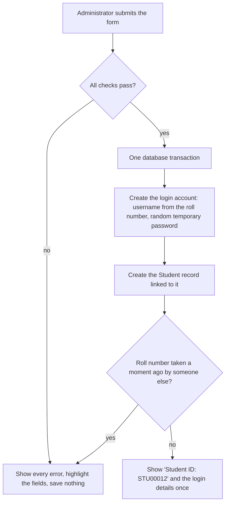

# Student Registration (FR-02 · Issues #27 to #31)

Traceability: FR-02 (R2), UC-02 · NFR-02 (simple UI), NFR-05 (data integrity) · Test Plan: `UT_04_Reg`, `UT_05_Reg`, `UT_06_Reg`, `ST_04_Reg` (and `IT_06_Reg` for the contact format), plus `UT_REG_07`, `UT_REG_08`, `IT_REG_07`

This batch covers the **Add New Student** workflow for administrators. Updating, searching and room-allocation eligibility (FR-02.05 to FR-02.08) are separate issues and are not part of it. The data model already existed (`core.Student`), so there are no migrations.

## What was built

| Issue | Story | Where |
|---|---|---|
| #28 | Student Management page with an **Add New Student** button; form with Name, Roll No., Contact, Address, Course, Year | `students/views.py`, `students/forms.py`, `templates/students/` |
| #29 | Save creates the record, generates a unique Student ID and confirms it | `students/services.py`, `core/models.py` (`Student.student_id`) |
| #30 | Duplicate Roll No. and email are rejected, the field is highlighted, nothing is saved | `students/forms.py`, `core/forms.py` |
| #31 | Blank mandatory fields are listed together, highlighted, and block saving | `students/forms.py`, `templates/students/student_form.html` |
| #27 | Epic. Stays open until FR-02.05 to FR-02.08 are done | |

Only **administrators** can open these pages (the menu item `Students` was already in the administrator menu).

## The registration form

| Field | Required | Rule |
|---|---|---|
| Name | yes | up to 160 characters |
| Roll No. | yes | letters, digits and `/ . _ -`; unique, ignoring case and surrounding spaces |
| Contact | yes | exactly 10 digits |
| Address | no | |
| Course | yes | |
| Year | yes | whole number from 1 to 8 |
| Hostel | yes | an active hostel; the administrator's own hostel is pre-selected |
| Email address | no | valid format; unique across students **and** login accounts, ignoring case |
| Guardian name, Guardian contact | no | guardian contact must be 10 digits |

All error texts come from `core/error_messages.py`, so they match the Test Plan (for example `Roll number already exists`). Errors for every field are shown together, each invalid input gets a red outline, and what the administrator typed is kept.

## How a student is saved



- **Student ID** is `STU` plus the record number padded to five digits (`STU00012`). It comes from the database primary key, so two students can never share an ID, it never changes, and nobody types it. That is why "reject duplicate Student ID" is satisfied by design: the form has no Student ID field, and a posted one is ignored.
- **Login account.** Every `Student` belongs to a `UserAccount` in this codebase, so registering a student also creates a login with the Student role. The username is the roll number in lower case (`CSE2201` becomes `cse2201`, or `cse2201-2` if taken). The temporary password is random (10 characters with upper case, lower case and a digit) and is shown **once** on the page after saving. Give it to the student; if it is lost, the student can use **Forgot password** when an email address was entered, or an administrator can set a new password in the Admin Site.
- **All or nothing.** The login account, the role record and the student are created in one transaction. If anything fails, none of them is saved.
- **Race safety.** The database also enforces a unique Roll No. If two administrators save the same roll number at the same moment, the second sees `Roll number already exists` instead of an error page.

## Try it

```bash
python manage.py migrate
python manage.py seed_data
python manage.py runserver
```

1. Log in as `admin01` / `Admin@12` and open **Students** in the menu, then **Add New Student**.
2. Save a student with valid data and note the Student ID and the temporary password.
3. Try roll number `CSE2201` (already exists), then leave Name and Roll No. blank.
4. Log in as the new student with the temporary password.

## Running the tests

```bash
python manage.py test students
python scripts/update_test_matrix.py students core accounts   # fills TEST_PLAN_MATRIX.md from the run
```
