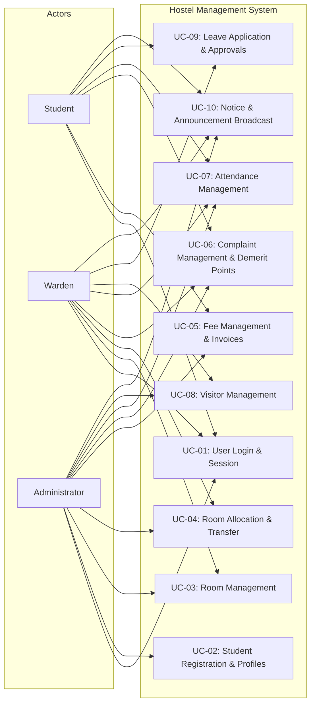

# Use Case Diagram & SRS Alignment Specification

**Module:** DOC.02 (Issue #176)  
**Parent Epic:** [DOC] Documentation & Requirement Clarifications (#174)  

---

## 1. Overview
This document aligns the system use case diagrams with the System Requirements Specification (SRS) and Use Case Flow documentation, rectifying previous discrepancies regarding actor boundaries and role permissions.

---

## 2. Actor-to-Use-Case Alignments

---

## 3. Explicit Boundary Clarifications
1. **Student Boundary:**
   - Students **do not** have access to *Student Registration* (UC-02) or *Room Allocation* (UC-04) configuration; they can only view their assigned room and profile.
   - Students have read access to published notices (UC-10) and can lodge complaints (UC-06), submit leave applications (UC-09), and view their own fee statements (UC-05).
2. **Warden Boundary:**
   - Wardens have full management of attendance (UC-07), visitor logs (UC-08), leave approvals (UC-09), and room status/vacancy updates (UC-03).
   - Wardens can investigate complaints and assign demerit points (UC-06).
   - Wardens can publish notices targeting students or all hostel residents (UC-10).
3. **Administrator Boundary:**
   - Administrators manage master student registrations (UC-02), room inventories (UC-03), fee structures, invoices, and payments (UC-05).
   - Administrators receive escalated complaints from wardens (UC-06).
