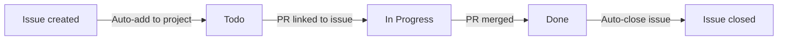

# GitHub Project Board Automation (SETUP.04 · Issue #5)

Traceability: NFR-06, NFR-07 · Test case: `UT_SETUP_03`

Project board: <https://github.com/users/Shashankb30/projects/5>

The board status must follow real git activity, so nobody has to drag cards by hand.

## Status flow

## Workflows enabled (Project → ⋯ → Workflows)

| # | Workflow | Setting | Result |
|---|----------|---------|--------|
| 1 | Auto-add to project | Repository: `Shashankb30/Hostel-Management-System`, filter `is:issue,pr` | New issues and PRs land on the board |
| 2 | Item added to project | Set `Status` = **Todo** | New cards start in Todo |
| 3 | Auto-add sub-issues to project | Enabled | Sub-issues appear on the board too |
| 4 | Pull request linked to issue | Set `Status` = **In Progress** | Card moves when a PR with `Fixes #N` is opened |
| 5 | Pull request merged | Set `Status` = **Done** | Card moves to Done on merge |
| 6 | Auto-close issue | Enabled (Status = Done) | Issue closes when the card reaches Done |

## Developer rules

1. Branch name: `feature/<issue-number>-<short-name>`.
2. The PR description must contain `Fixes #<issue-number>`; this is what links the PR to the issue and fires workflows 4–6.
3. Never move cards manually, except from Backlog to Todo at sprint start.

## Verification (UT_SETUP_03)

1. Create a test issue; it appears on the board with Status = Todo.
2. Add a sub-issue; it also appears on the board.
3. Open a PR with `Fixes #<test issue>`; the card moves to In Progress.
4. Merge the PR; the card moves to Done and the issue closes.
5. Delete or close the test items afterwards.
