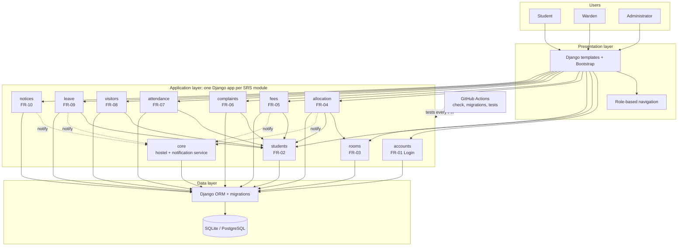
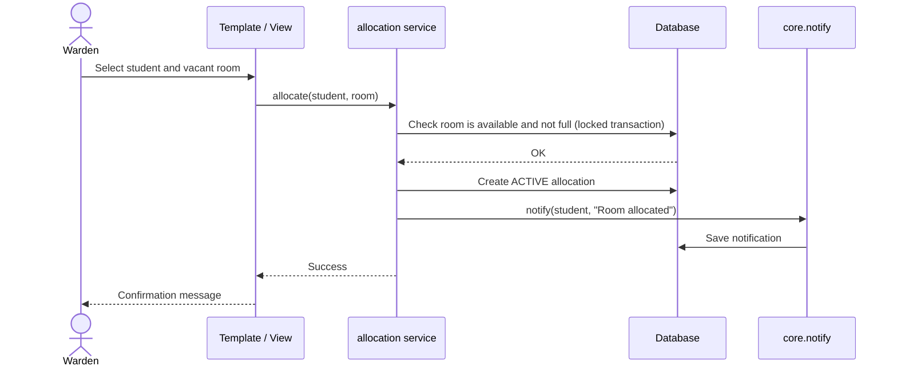

# Architecture Diagram

Layered, modular monolith (Python / Django). Draft: compare with the submitted SAD and record any difference as a deviation.

## 1. High-level architecture

## 2. Request flow (example: allocate a room)

## 3. Roles and access

| Role | Main modules |
|---|---|
| Student | Own room, own fees, complaints, leave, notices |
| Warden | Room allocation, attendance, visitors, leave approval, complaints, notices |
| Administrator | Students, rooms, fees, visitors, accounts, reports |

## 4. Design rules

1. Business rules live in each app's service layer, not in the views.
2. Modules interact through services and foreign keys only.
3. Every hostel-owned record carries a `hostel_id` (NFR-07).
4. Role checks use Django groups and permission decorators (NFR-01).
5. Database constraints back up every validation rule (NFR-05).
