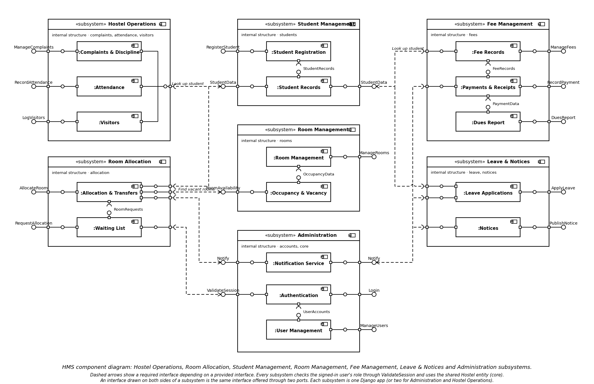
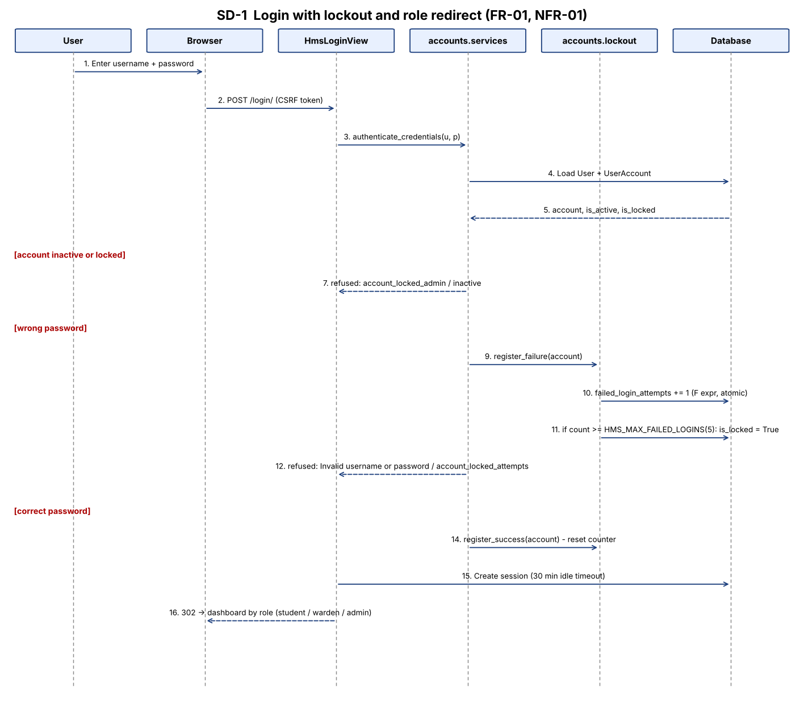
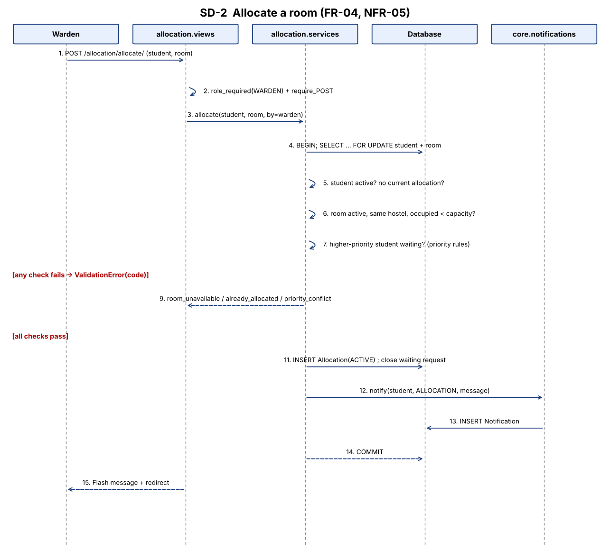
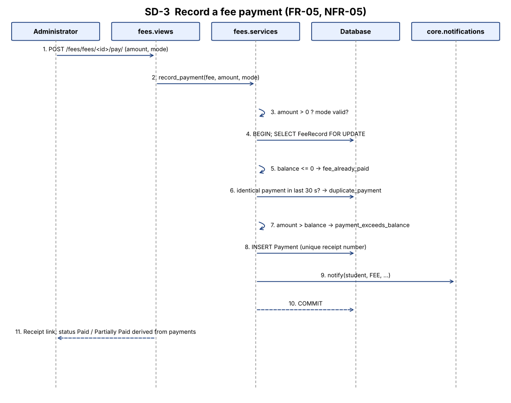

# Software Architecture & Design (SAD) Specification

**Hostel Management System (HMS)** — IEEE 1016-2009 (design description) and ISO/IEC/IEEE 42010 (architecture description) structure
Version 2.0 · 2026-11-05 · Course: Software Engineering (UE23CS341A) · Team: Shashankb30, abhijeetcyalgi

| Version | Date | Change |
|---|---|---|
| 1.0 | Oct 2026 | Architecture draft (views, layers, subsystems) |
| 2.0 | 2026-11-05 | Added: sequence diagrams, API design, error-handling protocol, security architecture, FR-to-component traceability, deviations; corrected file references and lock-out rule to match the code |

# 1. Introduction

## 1.1 Purpose
This SAD describes how HMS realises `docs/SRS.md`: its architectural pattern, components, security architecture, detailed design (sequence diagrams, API, error handling) and traceability to requirements.

## 1.2 Scope
All ten modules FR-01..FR-10 and the non-functional and security requirements NFR-01..NFR-08, SR-1..SR-7. The data model is in `Documents/design/er-diagram.md` and `Documents/design/schema.sql`.

## 1.3 Definitions
HMS, FR/NFR/SR as in the SRS. MVT = Django Model-View-Template. ORM = object-relational mapper. ADR = architecture decision record.

## 1.4 References
SRS `docs/SRS.md`; Test Plan `docs/Test_Plan.md`; ADR `Documents/adr/0001-tech-stack.md`; ER diagram `Documents/design/er-diagram.md`; `docs/DEVIATIONS.md`.

# 2. Architectural goals and constraints

| Goal | Source | Architectural response |
|---|---|---|
| Secure login, RBAC, safe passwords and sessions | NFR-01, SR-1..7 | Django auth + `role_required` decorator on every view, lock-out, CSRF, no-store cache middleware (section 5) |
| Responses ≤ 3 s | NFR-03 | Indexed lookups, derived values via aggregate queries, pagination (25/page) on student, leave, notice and visitor lists |
| Backup / restore | NFR-04 | `backup_database` and `restore_database` management commands (JSON fixture or SQLite file copy) |
| Integrity enforced by the database | NFR-05 | Unique, check and partial-unique constraints + service-layer rules + row locking |
| Modularity | NFR-06 | One Django app per SRS module; cross-module calls only via services and foreign keys |
| Multiple hostels | NFR-07 | `Hostel` entity; hostel-owned records carry a `hostel` foreign key |
| Availability signal | NFR-08 | `/health/` JSON endpoint (200 / 503) and maintenance page |

Constraints: two developers, two one-week sprints; student laptops (SQLite); delivery via GitHub issues, PRs and Actions.

# 3. Architectural representation (views)
| View | Question | Section |
|---|---|---|
| Use-case view | Which scenarios drive the design? | SRS Figure 1; section 4.1 |
| Logical view | How is the system decomposed? | 4 |
| Process view | How do parts cooperate at run time? | 6 (sequence diagrams) |
| Deployment view | Where does each part run? | 4.6 |
| Security view | How are assets protected? | 5 |

# 4. Architecture

## 4.1 Architectural pattern
HMS is a **layered, modular monolith** that applies **client–server** and Django's **MVT (Model-View-Template)** pattern:

| Layer | Components | Responsibility | May call |
|---|---|---|---|
| Presentation | `templates/`, role-based menu (`core/navigation.py`) | Render pages, forms, menus | Application |
| Application | `urls.py`, `views.py`, `forms.py`, `services.py` per app | Control flow, permission checks, business rules, notifications | Domain |
| Domain | `core/models.py` (constraints, derived properties) | Entities, invariants | Data |
| Data | Django ORM, migrations, SQLite / PostgreSQL | Persistence | — |

*Why not microservices?* One database, one deployment and two developers: a monolith with strict module boundaries gives the same modularity at far lower cost (ADR 0001).

## 4.2 Component diagram

## 4.3 Component descriptions
| Component (Django app) | SRS module | Responsibility | Key files |
|---|---|---|---|
| `core` | shared | Models for all entities, hostel entity, notifications, role helpers, validators, error-message catalogue, dashboards, health check, seed and backup commands | `core/models.py`, `roles.py`, `notifications.py`, `error_messages.py`, `views.py` |
| `accounts` | FR-01 | Login view, lock-out, session middleware, password reset, user administration | `accounts/services.py`, `lockout.py`, `middleware.py`, `user_service.py` |
| `students` | FR-02 | Registration (student + login created atomically), search | `students/services.py` |
| `rooms` | FR-03 | Room CRUD, derived occupancy/vacancy, deactivate/delete guards | `rooms/services.py`, `selectors.py` |
| `allocation` | FR-04 | Allocate, transfer, vacate, waitlist, priority rules, report | `allocation/services.py` |
| `fees` | FR-05 | Fee records, payments, receipts, dues report | `fees/services.py` |
| `complaints` | FR-06 | Complaints, misconduct, demerit rules, status workflow, escalation | `complaints/services.py` |
| `attendance` | FR-07 | Check-in/out, bulk, reports | `attendance/services.py` |
| `visitors` | FR-08 | Visitor log, check-out, history | `visitors/services.py` |
| `leave` | FR-09 | Apply, review, overlap detection, records | `leave/services.py` |
| `notices` | FR-10 | Publish, audience, expiry, board | `notices/services.py` |

## 4.4 Module dependencies (no cycles)
| Module | Depends on |
|---|---|
| accounts | core |
| students | accounts, core |
| rooms | core |
| allocation | students, rooms, core (notify) |
| fees | students, core (notify) |
| complaints | students, core |
| attendance | students, allocation data (active room), core |
| visitors | students, core |
| leave | students, core (notify) |
| notices | core (notify) |

## 4.5 Design principles applied
High cohesion (all rules of a module live in its `services.py`); loose coupling (apps share only `core` models and service calls); separation of concerns (views validate input and permissions, services hold rules, templates only render); abstraction (`core.notifications.notify()` hides how messages are stored).

## 4.6 Deployment view
| Node | Software | Notes |
|---|---|---|
| User device | Browser | No installation |
| Application server | Python 3.12, Django 5.2, WSGI (runserver in development; gunicorn behind a TLS reverse proxy in production) | One process per worker |
| Database | SQLite (dev) / PostgreSQL (prod) | Same migrations |
| GitHub | Repo, Project board, Actions | CI runs lint, system check, schema verification, migrations, tests and coverage on every push/PR |

## 4.7 Requirement-to-component traceability
| Requirement | Component(s) | Main design element | Test cases |
|---|---|---|---|
| FR-01, SR-3, SR-4 | accounts, core | `authenticate_credentials`, `lockout`, session settings | IT_LOGIN_06, ST_LOGIN_04 |
| FR-02 | students, core | `students.services`, unique constraints | UT_05_Reg, UT_06_Reg |
| FR-03 | rooms, core | `Room` unique + check constraint, `selectors` | UT_07_Room..UT_09_Room |
| FR-04 | allocation, rooms | `allocate()` with `select_for_update` (SD-2) | UT_11_Alloc, IT_10_Alloc, IT_11_Alloc |
| FR-05 | fees | `record_payment()` (SD-3) | UT_14_Fee, IT_13_Fee, ST_10_Fee |
| FR-06 | complaints | status workflow, `DemeritRule` | IT_16_Comp, IT_18_Comp |
| FR-07 | attendance | check-in/out rules | UT_21_Att, ST_14_Att |
| FR-08 | visitors | visitor log rules | UT_24_Vis, ST_16_Vis |
| FR-09 | leave | overlap detection | IT_27_Leave |
| FR-10 | notices | audience + expiry | UT_30_Notice, ST_20_Notice |
| NFR-01, SR-1, SR-2 | `core/roles.py` + every view | `role_required` | UT_NFR_01, UT_NFR_03, RBAC matrix |
| NFR-03 | all | indexes, pagination | UT_NFR_06, UT_NFR_07 |
| NFR-04 | core commands, error handlers | backup/restore, `handler4xx/5xx` | UT_NFR_08, UT_NFR_09 |
| NFR-05 | core.models, services | constraints + locking | UT_NFR_10 |
| NFR-07 | core.models | `hostel` FK | UT_NFR_12 |
| NFR-08 | core.views | `health_check` | UT_NFR_13 |

# 5. Security architecture

| Layer | Control | Where | SRS |
|---|---|---|---|
| Authentication | Salted PBKDF2-SHA256 hashes; password validators; custom `authenticate_credentials` refuses inactive/locked accounts | `accounts/services.py`, `config/settings.py` | SR-3 |
| Brute-force defence | Counter increments atomically (`F()` expression); at `HMS_MAX_FAILED_LOGINS` (default 5) `is_locked = True`; stays locked until an administrator unlocks it (UI or `manage.py unlock_account`) | `accounts/lockout.py` | SR-4 |
| Session | 30-min idle timeout renewed every request, expire at browser close, HttpOnly, SameSite=Lax; no-store cache headers on authenticated pages | settings, `accounts/middleware.py` | SR-4, SR-7 |
| Authorisation | `role_required(*roles)` on each view; a student additionally passes an ownership check on per-student URLs | `core/roles.py`, views | SR-1, SR-2 |
| Request integrity | CSRF middleware; state-changing views are `require_POST`; `X-Frame-Options: DENY`; `nosniff` | settings | SR-5 |
| Input / output | ORM-only queries (no raw SQL); auto-escaped templates; server-side validators in one catalogue | ORM, templates, `core/validators.py` | SR-6 |
| Data integrity | DB unique/check constraints; transactions with row locks | models, services | NFR-05 |
| Safe failure | Custom 400/403/404/500 handlers; no stack traces when `DEBUG=0`; transaction rollback | `config/urls.py`, `templates/4xx.html` | SR-7 |
| Secrets | `DJANGO_SECRET_KEY`, `DJANGO_DEBUG`, `DJANGO_ALLOWED_HOSTS` read from environment (`.env.example`) | `config/settings.py` | SO-4 |

Trust boundary: browser ↔ application server (HTTP/HTTPS); application ↔ database is internal. All input from the browser is untrusted.

# 6. Detailed design

## 6.1 Data model (summary)
Entities in `core/models.py`: Hostel, UserAccount, Student, Room, Allocation, AllocationRequest, AllocationRule, FeeRecord, Payment, Complaint, DemeritRule, ComplaintUpdate, DemeritRecord, AttendanceRecord, VisitorLog, LeaveApplication, Notice, Notification. Key constraints: unique (hostel, room_no); capacity ≥ 1; one active allocation per student (partial unique index); payment receipts unique. Full ER diagram: `Documents/design/er-diagram.md`.

## 6.2 Sequence diagrams

### SD-1 Login with lock-out (FR-01)

### SD-2 Allocate a room (FR-04)

### SD-3 Record a fee payment (FR-05)

## 6.3 API design
HMS is server-rendered, so its "API" is the set of HTTP routes below (Django URL conf). All state-changing routes are POST with a CSRF token. Forms re-display with field errors on HTTP 200; business-rule failures are shown as flash messages; the only JSON endpoint is `/health/`.

**Request / response conventions**

| Case | Response |
|---|---|
| Success of a POST | HTTP 302 redirect to the list/detail page with a success flash message |
| Validation error | HTTP 200, same form with per-field error text from `core/error_messages.py` |
| Business-rule error (`ValidationError` code) | HTTP 200/302 with an error flash message naming the rule |
| Not signed in / wrong role | HTTP 403 page (`403.html`) |
| Unknown object / URL | HTTP 404 page |
| GET on a POST-only route | HTTP 405 |
| Unexpected exception | HTTP 500 friendly page, transaction rolled back |

**Route catalogue (generated from the URL configuration, 80 routes)**

#### FR-01 accounts

| Method | Path | View | Access |
|---|---|---|---|
| GET | `/accounts/users/` | `user_list` | Administrator |
| GET, POST | `/accounts/users/new/` | `user_create` | Administrator |
| GET, POST | `/accounts/users/<int:pk>/edit/` | `user_edit` | Administrator |
| POST | `/accounts/users/<int:pk>/deactivate/` | `user_deactivate` | Administrator |
| POST | `/accounts/users/<int:pk>/reactivate/` | `user_reactivate` | Administrator |
| POST | `/accounts/users/<int:pk>/unlock/` | `user_unlock` | Administrator |
| GET, POST | `/login/` | `HmsLoginView` | Public |
| POST | `/logout/` | `logout_view` | Public |
| GET, POST | `/password-reset/` | `HmsPasswordResetView` | Public |
| GET | `/password-reset/done/` | `PasswordResetDoneView` | Public |
| GET, POST | `/reset/<uidb64>/<token>/` | `HmsPasswordResetConfirmView` | Public |
| GET | `/reset/done/` | `PasswordResetCompleteView` | Public |

#### FR-02 students

| Method | Path | View | Access |
|---|---|---|---|
| GET | `/students/` | `student_list` | Administrator |
| GET, POST | `/students/new/` | `student_add` | Administrator |

#### FR-03 rooms

| Method | Path | View | Access |
|---|---|---|---|
| GET | `/rooms/` | `room_manage` | Administrator |
| GET, POST | `/rooms/new/` | `room_add` | Administrator |
| GET, POST | `/rooms/<int:pk>/edit/` | `room_edit` | Administrator |
| POST | `/rooms/<int:pk>/delete/` | `room_delete` | Administrator |
| POST | `/rooms/<int:pk>/deactivate/` | `room_deactivate` | Warden, Administrator |
| POST | `/rooms/<int:pk>/reactivate/` | `room_reactivate` | Warden, Administrator |
| GET | `/rooms/vacancy/` | `room_vacancy` | Warden, Administrator |

#### FR-04 allocation

| Method | Path | View | Access |
|---|---|---|---|
| GET | `/allocation/` | `manage` | Warden |
| POST | `/allocation/allocate/` | `allocate` | Warden |
| GET, POST | `/allocation/transfer/<int:student_pk>/` | `transfer` | Warden |
| POST | `/allocation/vacate/<int:allocation_pk>/` | `vacate` | Warden |
| GET | `/allocation/waitlist/` | `waitlist` | Warden |
| POST | `/allocation/waitlist/add/` | `waitlist_add` | Warden |
| POST | `/allocation/waitlist/<int:pk>/remove/` | `waitlist_remove` | Warden |
| GET, POST | `/allocation/rules/` | `rules` | Warden |
| GET | `/allocation/report/` | `report` | Warden |
| GET | `/allocation/my-room/` | `my_room` | Student |

#### FR-05 fees

| Method | Path | View | Access |
|---|---|---|---|
| GET | `/fees/` | `manage` | Administrator |
| GET | `/fees/student/<int:student_id>/` | `student_fees` | Administrator |
| GET, POST | `/fees/student/<int:student_id>/fees/new/` | `fee_create` | Administrator |
| GET, POST | `/fees/fees/<int:fee_id>/edit/` | `fee_edit` | Administrator |
| GET, POST | `/fees/fees/<int:fee_id>/pay/` | `payment_create` | Administrator |
| GET | `/fees/payments/<int:payment_id>/receipt/` | `receipt` | Administrator, Student |
| GET | `/fees/my/` | `my_fees` | Student |
| GET | `/fees/dues/` | `dues_report` | Administrator |

#### FR-06 complaints

| Method | Path | View | Access |
|---|---|---|---|
| GET, POST | `/complaints/` | `my_complaints` | Student |
| GET | `/complaints/<int:pk>/` | `detail` | Any signed-in role |
| GET, POST | `/complaints/<int:pk>/edit/` | `edit` | Student |
| GET | `/complaints/manage/` | `manage` | Warden, Administrator |
| GET, POST | `/complaints/manage/misconduct/` | `log_misconduct` | Warden, Administrator |
| GET, POST | `/complaints/manage/rules/` | `rules` | Warden, Administrator |
| GET | `/complaints/manage/report/` | `report` | Warden, Administrator |
| POST | `/complaints/manage/<int:pk>/status/` | `update_status` | Warden, Administrator |
| POST | `/complaints/manage/<int:pk>/reopen/` | `reopen` | Warden, Administrator |
| POST | `/complaints/manage/<int:pk>/escalate/` | `escalate` | Warden, Administrator |

#### FR-07 attendance

| Method | Path | View | Access |
|---|---|---|---|
| GET | `/attendance/` | `my_attendance` | Student |
| GET | `/attendance/manage/` | `manage` | Warden, Administrator |
| POST | `/attendance/manage/check-in/` | `check_in` | Warden, Administrator |
| POST | `/attendance/manage/check-out/` | `check_out` | Warden, Administrator |
| POST | `/attendance/manage/bulk/` | `bulk` | Warden, Administrator |
| GET | `/attendance/manage/report/` | `report` | Warden, Administrator |
| GET | `/attendance/manage/student/<int:pk>/` | `student_history` | Warden, Administrator |

#### FR-08 visitors

| Method | Path | View | Access |
|---|---|---|---|
| GET | `/visitors/` | `visitor_log` | Warden, Administrator |
| GET, POST | `/visitors/add/` | `visitor_add` | Warden, Administrator |
| POST | `/visitors/<int:pk>/checkout/` | `visitor_checkout` | Warden, Administrator |
| GET | `/visitors/report/` | `visitor_report` | Warden, Administrator |
| GET | `/visitors/student/<int:student_id>/` | `student_visitor_history` | Any signed-in role |

#### FR-09 leave

| Method | Path | View | Access |
|---|---|---|---|
| GET | `/leave/my-leaves/` | `my_leaves` | Student |
| GET, POST | `/leave/apply/` | `apply_leave` | Student |
| GET, POST | `/leave/<int:pk>/resubmit/` | `resubmit_leave` | Student |
| POST | `/leave/<int:pk>/cancel/` | `cancel_leave` | Student |
| GET | `/leave/review/` | `review_list` | Warden, Administrator |
| GET, POST | `/leave/review/<int:pk>/` | `review_detail` | Warden, Administrator |
| GET | `/leave/records/` | `consolidated_records` | Warden, Administrator |

#### FR-10 notices

| Method | Path | View | Access |
|---|---|---|---|
| GET | `/notices/board/` | `board` | Any signed-in role |
| GET | `/notices/manage/` | `manage_notices` | Warden, Administrator |
| GET, POST | `/notices/add/` | `notice_add` | Warden, Administrator |
| GET, POST | `/notices/<int:pk>/edit/` | `notice_edit` | Warden, Administrator |
| POST | `/notices/<int:pk>/delete/` | `notice_delete` | Warden, Administrator |
| POST | `/notices/<int:pk>/expire/` | `notice_expire` | Warden, Administrator |

#### core

| Method | Path | View | Access |
|---|---|---|---|
| GET | `/` | `home` | Signed-in |
| GET (JSON) | `/health/` | `health_check` | Public |
| GET | `/maintenance/` | `maintenance_view` | Public |
| GET | `/dashboard/student/` | `dashboard_student` | Student |
| GET | `/dashboard/warden/` | `dashboard_warden` | Warden |
| GET | `/dashboard/admin/` | `dashboard_admin` | Administrator |

`GET /health/` response: `{"status": "healthy", "database": "connected", "service": "...", "version": "1.0.0", "timestamp": "..."}` → HTTP 200; HTTP 503 with `status: unhealthy` when the database is unreachable.

## 6.4 Error-handling protocol

1. **Validate at the edge.** Forms and `core/validators.py` check type, length, range and format. Messages come from one catalogue so the same mistake always gives the same text (e.g. "Room number already exists").
2. **Enforce rules in services.** Services raise `ValidationError(msg, code=...)` with a stable code (`room_unavailable`, `already_allocated`, `payment_exceeds_balance`, `duplicate_payment`, `no_active_checkin`, ...). Views catch it and show the message; they never swallow other exceptions.
3. **Make multi-step changes atomic.** Allocation, transfer, payment, registration and misconduct logging run in `transaction.atomic()`; any exception rolls everything back (UT_NFR_09).
4. **Back up rules with the database.** Unique / check / partial-unique constraints reject what a bug lets through; `IntegrityError` is caught and converted to the same user message in attendance, fees and rooms (and by form uniqueness checks elsewhere).
5. **Fail safely.** Unhandled errors render the friendly 400/403/404/500 templates; `DEBUG` is off in production so no stack trace or settings are shown.
6. **Login messages.** A wrong username or wrong password gives the same text, "Invalid username or password". For inactive or locked accounts the system names the reason (required by Test Plan IT_03_Login); this is a deliberate usability trade-off that reveals the account exists.
7. **Monitor.** `/health/` returns 503 when the database is unreachable.

| Failure | Detection | Handling | User sees |
|---|---|---|---|
| Invalid field | Form / validator | Form re-displayed | Field error |
| Rule violated | Service `ValidationError(code)` | Flash message, no write | Rule message |
| Concurrent conflict | Row lock + constraint | Second request refused | "Room unavailable" etc. |
| Forbidden access | `role_required` | HTTP 403 | Access-denied page |
| Missing record | `get_object_or_404` | HTTP 404 | Not-found page |
| Crash | `handler500` | Transaction rollback (no application logging is configured; see DEVIATIONS D-07) | Friendly error page |
| DB down | `/health/` | HTTP 503 | JSON status |

# 7. Quality attributes
| Attribute | Tactics | Verified by |
|---|---|---|
| Security | Section 5 | Test Plan 5.1 (SEC-01..10) |
| Performance (NFR-03) | Indexes (e.g. room hostel+active, attendance hostel+day), aggregate queries, pagination | `scripts/benchmark_performance.py`, UT_NFR_06 |
| Integrity | Constraints + locking | UT_NFR_10, allocation and fee concurrency tests |
| Modifiability | One app per module, services, no cycles | Lint in CI, review against 4.4 |
| Testability | Service layer separate from views; seed command; 681 automated tests, 94.9 % statement / 84.2 % branch coverage | `docs/reports/` |
| Recoverability | Backup/restore commands | UT_NFR_08 |

# 8. Deviations from the initial SRS / SAD
Deviations are listed, with reasons, in `docs/DEVIATIONS.md` and are to be explained in the demo. Summary: lock-out is administrator-unlock (not 15-minute timed); notice audiences are all/students/wardens; seniority is the only priority rule; audit logging is not implemented; extra features (password reset, waitlist, bulk attendance, leave resubmission).
