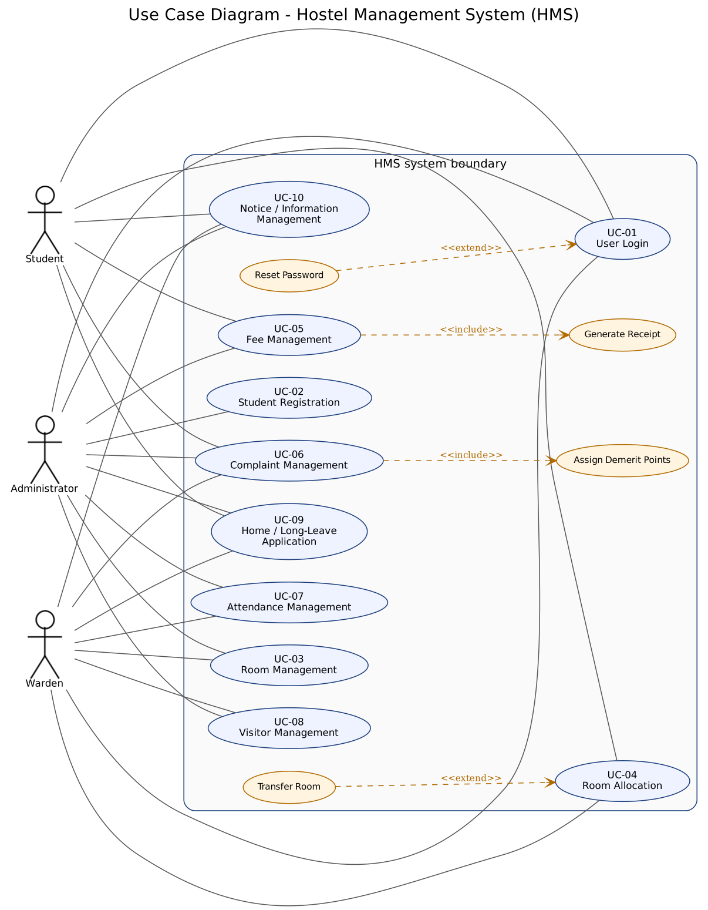

# Software Requirements Specification (SRS)

**Hostel Management System (HMS)** — IEEE 830-1998 / ISO/IEC/IEEE 29148 structure
Version 2.0 (final, post Sprint 2) · Date: 2026-11-05 · Course: Software Engineering (UE23CS341A) · Team: Shashankb30, abhijeetcyalgi

| Version | Date | Change |
|---|---|---|
| 1.0 | Sept 2026 | Initial SRS: FR-01..FR-10, NFR-01..NFR-08 |
| 2.0 | 2026-11-05 | IEEE restructure; measurable NFRs; security section (objectives + requirements); UML use case diagram embedded; requirement IDs for traceability; deviations listed in `DEVIATIONS.md` |

# 1. Introduction

## 1.1 Purpose
This document specifies the functional and non-functional requirements of the Hostel Management System (HMS), a web application that manages the student residency life-cycle of a university hostel. It is the reference for the Software Architecture & Design (SAD) document, the Test Plan and the GitHub backlog.

## 1.2 Scope
HMS supports three roles — **Student**, **Warden**, **Administrator** — and ten modules: login, student registration, room management, room allocation, fee management, complaint/misconduct management, attendance, visitor management, leave applications and notices. Out of scope: online payment gateways, biometric attendance, mobile native apps, SMS/e-mail delivery of notifications (notifications are in-app).

## 1.3 Definitions, acronyms and abbreviations
| Term | Meaning |
|---|---|
| HMS | Hostel Management System |
| FR / NFR / SR | Functional / Non-Functional / Security Requirement |
| UC | Use Case |
| RBAC | Role-Based Access Control |
| CSRF / XSS | Cross-Site Request Forgery / Cross-Site Scripting |
| Demerit points | Penalty points attached to a misconduct case by severity |
| Waitlist | Ordered queue of unallocated students waiting for a room |

## 1.4 References
1. IEEE Std 830-1998, *Recommended Practice for Software Requirements Specifications*; ISO/IEC/IEEE 29148:2018.
2. `docs/SAD.md` — Software Architecture & Design; `docs/Test_Plan.md` — Test Plan; `docs/DEVIATIONS.md`.
3. `Documents/Use_Case_Flow.docx` — detailed main/alternate/exception flows UC-01..UC-10.

## 1.5 Overview
Section 2 describes the product context. Section 3 lists specific requirements: interfaces (3.1), functional requirements (3.2), use case model (3.3), non-functional requirements (3.4), security requirements (3.5), design constraints (3.6) and the requirement-to-use-case map (3.7).

# 2. Overall Description

## 2.1 Product perspective
HMS is a self-contained, server-rendered web application (Python 3.12 / Django 5.2, SQLite for development, PostgreSQL-compatible schema). Users access it through a browser; there is no external system integration.

## 2.2 Product functions (summary)
Authenticate users and route them by role; register students; maintain rooms and capacity; allocate/transfer/vacate rooms with priority waitlist; record fees and payments with receipts and dues reports; log complaints and misconduct with demerit points; record attendance; log visitors; process leave applications; publish notices; send in-app notifications.

## 2.3 User classes and characteristics
| Role | Responsibilities | Technical skill |
|---|---|---|
| Student | View own room, fees, receipts, complaints, leave, notices | Basic web use |
| Warden | Allocate rooms, attendance, visitors, leave review, complaints, notices | Basic web use |
| Administrator | Students, rooms, fees, user accounts, reports, unlock accounts | Moderate |

## 2.4 Operating environment
Any modern browser (Chrome, Firefox, Edge, Safari); server: Python 3.12+, Django 5.2, WSGI server; database SQLite (dev) / PostgreSQL (production).

## 2.5 Assumptions and dependencies
One hostel is seeded by default; additional hostels are added as data. Time zone Asia/Kolkata. Users have an e-mail address for password reset (console e-mail backend in development).

# 3. Specific Requirements

## 3.1 External interface requirements
- **UI:** responsive HTML pages (Bootstrap), role-based navigation menu, consistent validation messages (catalogue in `core/error_messages.py`).
- **Software:** none external. **Hardware:** none beyond a browser device.
- **Communication:** HTTP/HTTPS; `GET /health/` returns JSON health status for monitoring.

## 3.2 Functional requirements

Each requirement is *testable*: the “Verification” column names the Test Plan case(s) (see `docs/Test_Plan.md`).

### FR-01 User Login (UC-01) — Student, Warden, Administrator
| ID | Requirement | Verification |
|---|---|---|
| FR-01.1 | The system shall authenticate users with a unique username and password and reject invalid credentials with the message "Invalid username or password". | UT_02_Login, UT_03_Login |
| FR-01.2 | After login the system shall redirect to the dashboard of the user's role (student / warden / administrator). | UT_02_Login, IT_01_Login, IT_02_Login |
| FR-01.3 | Inactive or locked accounts shall be refused with a message stating the reason. | IT_03_Login |
| FR-01.4 | An account shall be locked after 5 consecutive wrong passwords (configurable `HMS_MAX_FAILED_LOGINS`) and remain locked until an administrator unlocks it. | IT_LOGIN_06 |
| FR-01.5 | A session shall expire after 30 minutes of inactivity and be closed on logout; protected pages shall not be reachable with the Back button after logout. | ST_01_Login, ST_LOGIN_03, ST_LOGIN_04 |
| FR-01.6 | Empty credentials shall be rejected with validation errors. | ST_02_Login |
| FR-01.7 | A user shall be able to reset a forgotten password through a single-use e-mailed link. | UT_LOGIN_05 |
| FR-01.8 | An administrator shall create, edit, deactivate/reactivate and unlock accounts; usernames are unique; roles are limited to the three defined. | IT_LOGIN_04, IT_LOGIN_05 |

### FR-02 Student Registration (UC-02) — Administrator
| ID | Requirement | Verification |
|---|---|---|
| FR-02.1 | The administrator shall add a student with name, roll number, contact, address, course and year; the system shall generate a unique, immutable Student ID. | UT_04_Reg, UT_05_Reg, UT_REG_08 |
| FR-02.2 | Duplicate roll numbers and e-mail addresses (case-insensitive) shall be rejected. | UT_06_Reg, UT_REG_07 |
| FR-02.3 | Phone numbers shall be exactly 10 digits; mandatory fields shall be validated server-side. | IT_06_Reg, ST_04_Reg |
| FR-02.4 | The administrator shall update student details and search/filter students by name. | IT_04_Reg, ST_03_Reg |
| FR-02.5 | A newly registered student shall appear in the allocation candidate list and shall receive a login account created atomically with the student record. | IT_05_Reg, IT_REG_07 |

### FR-03 Room Management (UC-03) — Administrator (Warden: availability)
| ID | Requirement | Verification |
|---|---|---|
| FR-03.1 | The administrator shall add rooms with unique room number per hostel, capacity ≥ 1 and type; a new room is "Vacant". | UT_07_Room, UT_08_Room, UT_09_Room |
| FR-03.2 | Occupancy and vacancy shall be derived from active allocations and update automatically. | IT_07_Room, IT_08_Room |
| FR-03.3 | Room detail changes shall be visible to allocated students. | IT_09_Room |
| FR-03.4 | Rooms shall be filterable by vacancy; a room with active occupants shall not be deleted. | ST_05_Room, ST_06_Room |

### FR-04 Room Allocation (UC-04) — Warden
| ID | Requirement | Verification |
|---|---|---|
| FR-04.1 | The warden shall allocate only vacant, active rooms of the student's hostel; allocation beyond capacity shall be refused ("Room unavailable"). | UT_10_Alloc, UT_11_Alloc, IT_10_Alloc |
| FR-04.2 | A student shall hold at most one active allocation; a second room requires a transfer. | IT_11_Alloc |
| FR-04.3 | Allocation shall follow priority rules (seniority: higher year first) using a waiting list; the warden may override with confirmation. | UT_12_Alloc |
| FR-04.4 | A transfer shall update occupancy of both rooms and keep the old allocation as history; vacating frees the bed. | IT_12_Alloc |
| FR-04.5 | If no room is free the system shall show "No vacant rooms available" and offer the waitlist; an allocation report shall be available. | ST_07_Alloc, ST_08_Alloc |
| FR-04.6 | Concurrent requests shall never exceed room capacity (row locking inside a transaction). | NFR-05 tests |

### FR-05 Fee Management (UC-05) — Administrator, Student
| ID | Requirement | Verification |
|---|---|---|
| FR-05.1 | The administrator shall define fee records (year, description, amount > 0) per student; total, paid and outstanding shall be shown. | UT_13_Fee |
| FR-05.2 | Payments shall be recorded with amount, mode and date; status is derived: *Paid*, *Partially Paid*, *Unpaid*. | UT_14_Fee, UT_15_Fee |
| FR-05.3 | Payments that are ≤ 0, non-numeric or exceed the outstanding balance shall be rejected. | IT_13_Fee, IT_14_Fee |
| FR-05.4 | An identical payment repeated within 30 seconds shall be rejected as a duplicate; each payment shall have a unique receipt number. | ST_10_Fee |
| FR-05.5 | Students shall see only their own fees, payments and receipts; the administrator shall see payment history and an outstanding-dues report. | IT_15_Fee, ST_09_Fee |

### FR-06 Complaint Management (UC-06) — Student, Warden, Administrator
| ID | Requirement | Verification |
|---|---|---|
| FR-06.1 | A student shall submit a complaint with category and non-empty description; it is created with status *Open* and a unique ID. | UT_16_Comp, UT_17_Comp |
| FR-06.2 | Staff shall list/filter complaints, change status (Open → Under Review → Resolved) with remarks, reopen, and escalate to the administrator; the student is notified. | UT_18_Comp, IT_17_Comp |
| FR-06.3 | Misconduct shall carry a severity; the system shall assign the configured demerit points and accumulate them per student. | IT_16_Comp, IT_18_Comp |
| FR-06.4 | A resolved complaint shall not be editable until reopened; a category summary report shall be available. | ST_11_Comp, ST_12_Comp |

### FR-07 Attendance Management (UC-07) — Warden, Administrator
| ID | Requirement | Verification |
|---|---|---|
| FR-07.1 | Staff shall record check-in and check-out with timestamps for allocated students. | UT_19_Att, UT_20_Att |
| FR-07.2 | A second check-in without check-out, or a check-out without check-in, shall be refused with a clear message. | UT_21_Att, ST_14_Att |
| FR-07.3 | Staff shall mark attendance in bulk and view a daily summary and date-range report; entries link to the student profile. | IT_19_Att, IT_20_Att, IT_21_Att, ST_13_Att |

### FR-08 Visitor Management (UC-08) — Administrator, Warden
| ID | Requirement | Verification |
|---|---|---|
| FR-08.1 | A visitor entry shall require name, ID proof, purpose and student visited; check-in time is recorded. | UT_22_Vis, UT_23_Vis, UT_24_Vis |
| FR-08.2 | Check-out shall update the same entry with the visit duration; a second check-out is refused. | IT_22_Vis, ST_16_Vis |
| FR-08.3 | Visitor logs shall link to the host student and be searchable and reportable by date/student. | IT_23_Vis, IT_24_Vis, ST_15_Vis |

### FR-09 Home / Long-Leave Application (UC-09) — Student, Warden, Administrator
| ID | Requirement | Verification |
|---|---|---|
| FR-09.1 | A student shall apply with from/to dates and a reason; status starts *Pending*; end before start or missing reason is rejected. | UT_25_Leave, UT_26_Leave, UT_27_Leave |
| FR-09.2 | Staff shall approve or reject (remarks) a pending application; the student is notified. | IT_25_Leave, IT_26_Leave |
| FR-09.3 | Overlap with an approved leave shall be flagged to the reviewer. | IT_27_Leave |
| FR-09.4 | Students shall see their own history; staff shall see consolidated records. | ST_17_Leave, ST_18_Leave |

### FR-10 Notice / Information Management (UC-10) — Warden, Administrator
| ID | Requirement | Verification |
|---|---|---|
| FR-10.1 | Staff shall publish notices (non-empty title, body, audience all/students/wardens, optional expiry). | UT_28_Notice, UT_29_Notice |
| FR-10.2 | Published notices shall appear on the audience's board, newest first; edited notices show updated content; deleted/expired notices disappear. | UT_30_Notice, IT_28_Notice, IT_29_Notice, IT_30_Notice |
| FR-10.3 | Notices shall be searchable by keyword; only Warden/Administrator may create them. | ST_19_Notice, ST_20_Notice |

## 3.3 Use case model

| UC | Name | Actors | Realises |
|---|---|---|---|
| UC-01 | User Login | Student, Warden, Administrator | FR-01 |
| UC-02 | Student Registration | Administrator | FR-02 |
| UC-03 | Room Management | Administrator, Warden | FR-03 |
| UC-04 | Room Allocation | Warden | FR-04 |
| UC-05 | Fee Management | Administrator, Student | FR-05 |
| UC-06 | Complaint Management | Student, Warden, Administrator | FR-06 |
| UC-07 | Attendance Management | Warden, Administrator | FR-07 |
| UC-08 | Visitor Management | Administrator, Warden | FR-08 |
| UC-09 | Home / Long-Leave Application | Student, Warden, Administrator | FR-09 |
| UC-10 | Notice / Information Management | Warden, Administrator | FR-10 |

Main, alternate and exception flows for each use case are in `Documents/Use_Case_Flow.docx`.

## 3.4 Non-functional requirements (measurable)

| ID | Category | Requirement (measurable) | Measure / acceptance | Verification |
|---|---|---|---|---|
| NFR-01 | Security | Only authenticated users reach any page except login, password reset and `/health/`; every module endpoint enforces its allowed roles (see 3.5). | 100 % of role-protected routes return 403 / redirect for other roles | UT_NFR_01, UT_NFR_03 |
| NFR-02 | Usability | A first-time user shall complete the primary task of their role (student: view fees; warden: allocate a room; admin: add a student) without help. Every form error names the field and the fix. | ≤ 3 clicks from the dashboard to any primary task; 100 % of validation messages come from the single message catalogue | UT_NFR_05 (manual), core.test_validators |
| NFR-03 | Performance | Login, search, room allocation and record updates respond within 3 s under normal load (≤ 20 concurrent users, ≤ 1000 students). | Max response time over 5 samples per endpoint < 3.0 s (`scripts/benchmark_performance.py`) | UT_NFR_06 |
| NFR-04 | Reliability | Records survive failures: a full backup and restore round-trip loses no rows; multi-step changes are atomic; errors never show a stack trace. | Restore of a backup reproduces 100 % of rows; 400/403/404/500 pages render friendly text | UT_NFR_08, UT_NFR_09 |
| NFR-05 | Data integrity | The database rejects duplicate students, invalid allocations and inconsistent payments regardless of the UI (unique, check and partial-unique constraints plus service rules). | 0 duplicate roll numbers/e-mails; occupancy never > capacity; paid ≤ fee amount | UT_NFR_10 |
| NFR-06 | Maintainability | One Django app per module; modules interact only through services and foreign keys; no cyclic app dependencies; CI lint passes. | `ruff check .` reports 0 issues; dependency graph in SAD §5.2 has no cycles | UT_NFR_11 (static check) |
| NFR-07 | Scalability | New hostels and blocks are added as data, not code; every hostel-owned record carries a hostel reference; list pages are paginated (25 per page on student, leave, notice and visitor lists). | A second hostel can be created and isolated from the first without code change | UT_NFR_12, UT_NFR_07 |
| NFR-08 | Availability | A health endpoint reports web + database status so monitoring can detect downtime; planned maintenance shows a maintenance page. | `GET /health/` → HTTP 200 `{"status": "healthy"}` or 503 when DB is down | UT_NFR_13 |

## 3.5 Security requirements

### 3.5.1 Security objectives
| ID | Objective |
|---|---|
| SO-1 | **Confidentiality** — students' personal, fee, complaint and leave data is visible only to the student concerned and to authorised staff. |
| SO-2 | **Authentication assurance** — only legitimate account holders can sign in; brute-force guessing is stopped. |
| SO-3 | **Integrity and non-repudiation** — records cannot be altered through forged or replayed requests, and key actions are attributable to a user. |
| SO-4 | **Availability and safe failure** — errors and attacks must not expose internals or take the service down. |

### 3.5.2 Security requirements
| ID | Requirement | Objective | Implemented by | Verification |
|---|---|---|---|---|
| SR-1 | Role-based access control on every route (`role_required`); other roles receive HTTP 403, anonymous users are sent to login. | SO-1 | `core/roles.py`, per-app view decorators | UT_NFR_01 |
| SR-2 | A student shall not read another student's data (rooms, fees, receipts, complaints, leave). | SO-1 | ownership filters in views/services | UT_NFR_03 |
| SR-3 | Passwords are stored salted-hashed and must pass validators (similarity, min length, common, numeric); reset links are single-use. | SO-2 | Django auth, `AUTH_PASSWORD_VALIDATORS` | UT_NFR_02, UT_LOGIN_05 |
| SR-4 | An account locks after 5 consecutive failed logins until an administrator unlocks it; sessions expire after 30 min idle and are HttpOnly, SameSite=Lax. | SO-2 | `accounts/lockout.py`, settings | IT_LOGIN_06, ST_LOGIN_04 |
| SR-5 | All state-changing requests require POST and a valid CSRF token; clickjacking is denied (`X-Frame-Options: DENY`); content-type sniffing is disabled. | SO-3 | `CsrfViewMiddleware`, `require_POST`, security settings | UT_NFR_01 |
| SR-6 | User input is escaped on output and queried through the ORM (no string-built SQL) to prevent XSS and SQL injection. | SO-3 | Django templates + ORM | UT_NFR_04 |
| SR-7 | Pages for logged-in users are sent with no-store cache headers; error handlers never reveal stack traces. | SO-4 | `NoStoreForAuthenticatedMiddleware`, `handler400/403/404/500` | ST_LOGIN_03, UT_NFR_09 |

## 3.6 Design constraints
Two-person team, two one-week sprints (19–23 Oct and 26–30 Oct 2026); GitHub issues/PRs/Actions mandatory; free/open-source tools only; code may be AI-assisted but must conform to this SRS, the SAD and the Test Plan.

## 3.7 Requirement-to-use-case matrix
FR-01→UC-01 · FR-02→UC-02 · FR-03→UC-03 · FR-04→UC-04 · FR-05→UC-05 · FR-06→UC-06 · FR-07→UC-07 · FR-08→UC-08 · FR-09→UC-09 · FR-10→UC-10 · NFR/SR→all use cases.

# 4. Appendix — Role / access matrix (derived from the implemented routes)
| Module | Student | Warden | Administrator |
|---|---|---|---|
| Accounts (users, unlock) | — | — | full |
| Students | — | — | full |
| Rooms | — | vacancy, deactivate/reactivate | full |
| Allocation | own room | full | — |
| Fees | own fees, receipts | — | full |
| Complaints | own complaints | manage, misconduct, escalate | manage |
| Attendance | own history | manage | manage |
| Visitors | own visitor history | full | full |
| Leave | apply/cancel/own history | review, records | review, records |
| Notices | read board | publish/manage | publish/manage |
